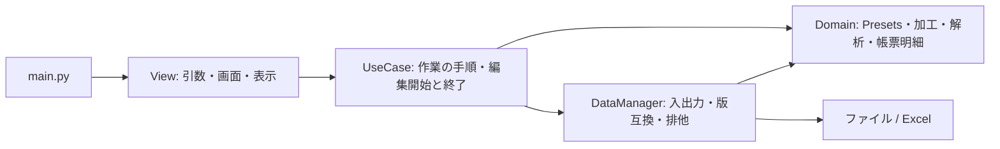
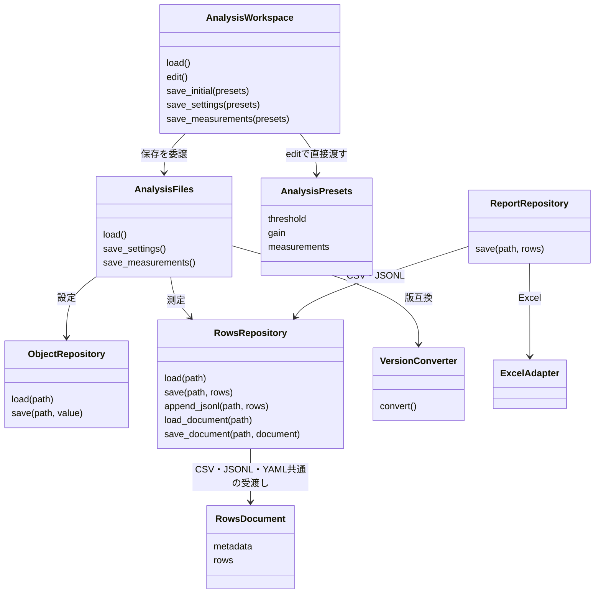

# この構成の狙いと利点

少人数で保守する際に、変更する場所を理由から見つけられることを優先しました。画面の変更はView、手順の変更はUseCase、計算の変更はDomain、保存仕様の変更はDataManagerへ集めます。同じ設定項目をレイヤごとに機械的に再定義する構成ではありません。

Viewはファイルの拡張子や版変換を知る必要がありません。Domainの計算はファイルを開かないため、画面やファイルなしでも検証できます。DataManagerはUseCaseを参照しません。この依存方向はtests/test_layers.pyで確認しています。

## どの単位で分けたか

| 担当 | 実装 | 変更の理由 |
|---|---|---|
| 操作・表示 | View/end_to_end.py | 引数や画面、通知先が変わる |
| 全体の手順 | UseCase/end_to_end.py | 工程・再読込・保存タイミングが変わる |
| 編集の管理 | UseCase/analysis.py | 編集権、保存確定時の検証の扱いが変わる |
| 処理入力と計算 | Domain/models.py、processing.py、analysis.py | 処理に必要な値、計算が変わる |
| 保存一式の対応付け | DataManager/analysis_files.py | 保存ファイルの組合せが変わる |
| 保存版の意味 | DataManager/settings_versions.py | キー改名・廃止・保持方針が変わる |
| 汎用ファイル入出力 | DataManager/repositories.py | ファイル操作や形式の対応が変わる |
| 形式の文法 | DataManager/serializers/ | JSON等の読書き方法が変わる |
| Excelへの接続 | DataManager/Excel/adapter.py | 業務明細と帳票Record/Itemの対応が変わる |

ファイルやBaseModelが一つ増えるたびにUseCaseサービスを作る必要はありません。同じ業務の保存一式ならAnalysisFilesのような窓口にまとめます。Repositoryの設定だけで足りるものは、examples/application_services.pyのように組み合わせるだけにします。

## 計算と編集の境界

Domainの`analyze_readings(presets)`は入力を変更せず、`AnalysisResult`を返します。UseCaseの`apply_analysis_result(presets, result)`で並び順を反映し、AnalysisWorkspaceで変更したファイルを保存します。計算・変更・保存が別操作なので、計算だけの確認や保存前の結果確認ができます。

Presetsは処理に必要な値を持ち、Workspaceは編集権を持ちます。解析のためだけにWorkspaceを生成する必要はありません。計算処理に再利用する状態がなければ、関数のままにします。

## クラスの関係

管理オブジェクトを経由してeditor.presets.thresholdと辿る必要はありません。`with service.edit() as presets:`から受け取ったPresetsをそのまま処理し、変更したファイルに対応する保存メソッドだけを呼びます。保存用Settingsと処理用Presetsは、同じ形だから分けるのではなく、保存版と処理入力の変化を切り離す必要がある範囲で分けています。

Repositoryはファイル操作、Serializerは形式、モデル変換はmodel_conversion、版変換はversioningへ委譲します。全形式共通の巨大なオプション辞書や、未定義項目をNoneで補う仕組みは持たせていません。

ExcelエンジンはDataManager/Excel内に同梱しました。DomainのReportRowはExcelを継承しません。adapterが帳票エンジン専用のRecord/Itemへ変換するため、同じ明細からCSV・JSONLにも出力できます。帳票を加工・解析へ読み戻す機能は提供しません。

CSVの先頭key,valueとJSONLの利用者メタはRowsDocumentへ揃えました。形式固有の境界はSerializerが担当し、Repositoryは業務キーを解釈しません。詳細は[メタ情報API](METADATA.md)を参照してください。

ファイル入出力の窓口はFileService / FileReader / FileWriterへ揃えました。版変換はRepositoryへの委譲、加工入力はUseCase.processing、解析の編集管理はAnalysisWorkspaceです。[命名とI/Fの規則](FILE_INTERFACES.md)を参照してください。

YAMLの一覧はYamlRowsSerializer、単一文書の合成はYamlSerializerへ分けています。解析・値検証はyaml_values.pyを共用します。[YAML Rows](YAML_ROWS.md)を参照してください。
