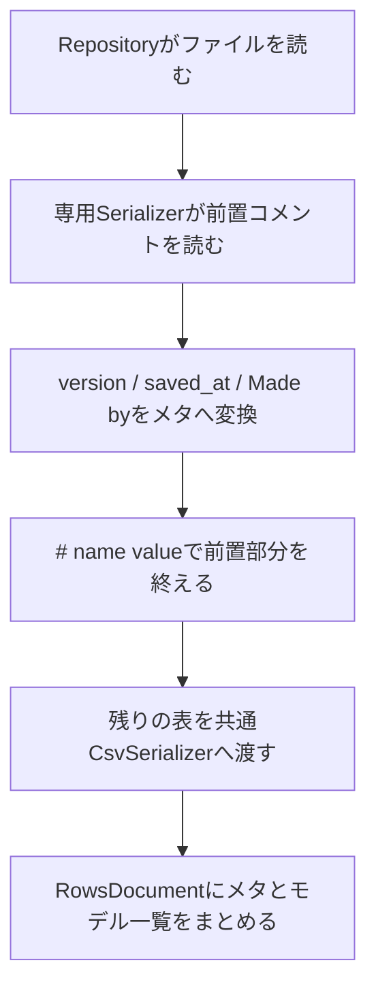

# コメント付きCSV：共通処理と専用処理の分担

`python -m examples.csv_comments`でi〜i5を読み込みます。ファイルは作成しません。
各形式の設定は`examples/csv_comments.py`の独立した関数にあります。

| 入力 | 関数 | 担当 |
|---|---|---|
| i.csv | sample_i | 共通CSV。先頭1行をコロン区切りのメタとして読む |
| ii.csv | sample_ii | 共通CSV。同じメタに`# `接頭辞を指定する |
| iii.csv | sample_iii | 共通CSV。先頭の説明コメントを飛ばし、指定した列名行から読む |
| iii_1.csv | sample_iii_1 | 共通CSV。説明コメントの後にversion・countのメタを読む |
| iiii.csv | sample_iiii | 同じ専用Serializer。version・saved_atを必須にする |
| i5.csv | sample_i5 | 同じ専用Serializer。user・updated_atも必須にする |

## なぜ分けるのか

共通CSVの設定で説明コメントや自由文まで表そうとすると、モードや組合せの検証が増えます。
定型メタは既存設定を使い、ファイル固有の文法は短い専用コードで表します。

`DataManager/serializers/sample_comment_csv.py`の`SampleCommentCsvSerializer`は、
今回のiiii・i5という形式群を読む**専用実装の見本**です。任意のコメント付きCSVを読む汎用クラスではありません。
実際の形式では、意味が分かる形式名にし、列名・メタ項目・自由文の解釈をその中へ記述します。

## iii・iii_1：共通CSVの読み込み

設定は「説明を表す記号」と「列名行」の二つです。説明の行数は数えません。
iiiでは次の指定だけで読めます。

```python
serializer = CsvSerializer(options=CsvOptions(
    delimiter=" ", column_prefix="# ",
    comment_prefixes=("#",), header_line="# name value",
))
```

`comment_prefixes`は先頭の説明を読み飛ばすための記号です。
`header_line`は**入力ファイル上の列名行そのもの**です。同じ#で始まる説明と列名を区別するために指定します。
行の前後空白を除いて照合します。内部の区切りや引用表現は、ファイルの記載と合わせます。
`column_prefix`は、見つけた列名行から#を外してCSVとして読む既存の設定です。

iii_1は、上記のoptionsへ既存のメタ宣言を加えます。

```python
metadata=CsvHeaderOptions(fields=(
    CsvHeaderField.whitespace("version"),
    CsvHeaderField.separated("count"),
))
```

読み込みは「先頭の説明を飛ばす → メタを読む → 列名と本文を読む」の順です。
説明の読み飛ばしは列名行、または最初の非コメント行で止まります。
iii_1では`version 1`で止まり、以後を既存のメタ処理へ渡します。
本文にある#や引用符内改行には触れません。

iii_1のメタは`{"version": "1", "count": "2"}`、iiiは空辞書になります。
本文が空白区切りでも、名前付きメタは元の行から解釈し、値中の連続空白を維持します。
先頭の説明コメントが増減しても設定は同じです。ファイル途中の説明や自由文のメタ抽出は専用処理の担当です。

説明コメントの元配置は保存しません。共通CSVで整形して出力できます。
`header_line`は入力の識別用であり、出力の列名は既存のcolumns・モデル・by_aliasから作ります。
入力の列名を置換して出力する場合など、出力の見出しがheader_lineと異なる場合は、出力用設定を別に構成します。

## iiii・i5：専用Serializerの読み込み



専用Serializerの`loads_document`を見ると、この順序で処理が並びます。
`_read_metadata`には、キー付きメタとMade by行の二種類の読み方だけを置きます。
本文の引用符・空白区切り・列数・モデル変換は共通CSVに任せ、実装を重複させません。

i5の`Made by taro yamada at 2026/11/10`は次のメタになります。

```python
{"user": "taro yamada", "updated_at": "2026/11/10"}
```

`required_metadata`は、その入力で欠かせないキーだけを指定します。
専用処理では重複・必須メタの欠落・列名行の不足を確認します。
日付は文字列です。業務上の日付検証などが必要ならRepositoryの`metadata_model`を利用します。

## 呼び出しと保存

共通CSVでも専用Serializerでも、Repositoryからは`load_document()`で呼べます。
形式ごとのRepositoryやServiceを増やす必要はありません。版変換へ渡す文書の構造も同じです。

専用Serializerは**読取専用**です。説明の配置や自由文を勝手に別の書式へ書き換える処理は持たせていません。
共通CSV・JSONLとして出力するなら、出力用Repositoryに同じRowsDocumentを渡します。
元形式への保存が必要になった時点で、その形式の出力規則を専用Serializerへ実装します。

## 前回から取り除いたもの

共通CsvHeaderOptionsの`as_text / before_columns / captures`、抽出式の設定・検証、
前置部分を走査する共通処理、保存後に再読できるかを確かめるための再解析を外しました。
`CsvKeyValueHeaderOptions.as_text`は以前からの定型メタの機能として残っています。
a〜g・AA・AAAの既存設定は変更していません。
