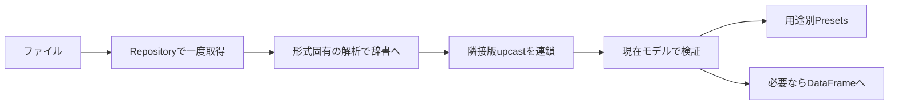

# 拡張形式・版互換・共有編集権をつなぐ

この改修は、2026-11-09までの合意を反映しています。KV・独自テキストの元の説明コメントや配置の保持は対象外です。未提示の入力文法は人工データで具体化してあり、社内ファイルの実仕様を実装済みという意味ではありません。

## どこに処理を足すか

| 変更の理由 | 担当・実装 |
|---|---|
| CSVの基本的な読書き規則 | `CsvOptions` / `serializers/csv_options.py` |
| コメントヘッダ・キーと値 | `KvOptions` / `serializers/kv.py` |
| 複数行で一レコード | `BlockRowsSerializer` / `serializers/block_rows.py` |
| 対象固有の構造・マーカー・列数計算 | 専用Serializer。架空例は`serializers/sample_capture.py` |
| 隣接版キャストの順序 | `VersionConverter` / `VersionedObjectRepository` / `VersionedRowsRepository` |
| 表の列・dtype・欠損値 | `frames.py`の`to_frame` / `from_frame` |
| 保存領域と編集権 | `storage.py`の`Storage` / `EditSession` |
| 編集から保存までの手順 | `UseCase/analysis.py`の`AnalysisWorkspace` |

形式が増えるたびにRepositoryを複製しません。独自Serializerは既存のObjectRepositoryまたはRowsRepositoryへ登録します。多数のオプションで文法を表現できない場合は、普通のPythonコードで専用Readerを作り、位置の解釈だけをそこへ閉じ込めます。



## CSVの本文と固定ヘッダを構成する

```python
from DataManager import CsvOptions, CsvHeaderOptions, CsvHeaderField, CsvSerializer

serializer = CsvSerializer(
    options=CsvOptions(columns=("time", "reading")),
    metadata=CsvHeaderOptions(fields=(
        CsvHeaderField("version", separator=None),
        CsvHeaderField("device", separator=None),
    )),
)
```

先頭2レコードの値へversion/deviceという名前を与えます。本文の見出しは消費し、指定したtime/readingへ置き換えます。列名がない場合はCsvOptions(header=False, columns=(...))を使います。置換時はファイル見出しの件数ではなく、本文のセル数と指定名を照合します。

ヘッダの各項目はCsvHeaderField、項目宣言のないkey-valueメタはCsvKeyValueHeaderOptionsへ分けました。旧CSVDumpOptions / CSVLoadOptions / CSVMetadataOptionsと旧コンストラクタ引数は廃止しています。全項目の条件とa〜gの実例は[CSV設定ガイド](CSV_OPTIONS.md)を参照してください。

## KVは識別行を持たない

```python
from DataManager import KvOptions, KvSerializer

reader = KvSerializer(options=KvOptions(
    comment_prefixes=("#", ";"),
    key_value_separator=":",
).with_value_header(("saved_at", "version", "saved_path"), skip=1))
```

先頭のコメント群から、説明1件を飛ばして日時・版・保存先を取得します。ヘッダ自体がキー付きならwith_key_value_header(skip=1)を指定し、キー一覧は渡しません。日時やパスのコロンは分割しません。本文のキーと値の区切りには空白も指定できます。行末コメントは二重引用符の外側で空白の後に始まる記号だけを対象にします。値そのものの記号は引用符で保護します。

保存用の識別行は出力・要求しません。通常保存は既定のKvSerializerでkey:JSON値へ揃え、文字列・数値・Noneの型を維持します。業務項目のversionは通常の値として残ります。ヘッダ抽出や空白区切りを指定した入力専用設定での保存はエラーにし、標準出力用のRepositoryへ渡すことを明示します。元の自由コメント・ヘッダ配置の書式保持は行いません。

## 複数行と、2テーブルの例

`sample_data/extended/multiline_records.txt`は、先頭の複数行列定義と同じ行構成で値が続き、最後のレコードも#で閉じる文法です。BlockRowsSerializerは各行の列数を照合してから一つのモデルへ復元します。保存する場合はBlockRowsOptions.columnsに行ごとの列を指定します。セル内の改行と、終端行と同じ内容のデータ行は対象外です。

`sample_data/extended/compound.csv`は架空の2テーブルCSVです。先頭のnumberで前半の件数、channel_countで後半の列数を決めます。件数で求めた位置と[header2]を照合し、後半は列名なしでchannel_1、channel_2…というキーを付けます。

前半・後半のRowsRepositoryへCaptureSectionSerializer("first") / ("second")を登録します。共通のCaptureCsvFormatが同じ読取内容からヘッダと必要な表を復元し、別Repositoryの読込結果を流用しません。2つのRepositoryのloadを別々に呼べば、それぞれ別時点のスナップショットです。同時点の両表が必要ならCaptureCsvFileSerializerで全体を一度取得してください。

全体の新規保存はObjectRepositoryへCaptureCsvFileSerializerを登録し、first/secondそれぞれのmetadataとrowsを渡します。片方だけの更新は提供しません。

キーなし空白区切りの架空例はPositionalCaptureSerializerです。構造を辞書へ戻す読取専用の例で、標準KV/JSONへ出す場合は別の出力Repositoryを使います。

属性行の同名キーをattrsへまとめる形式もBlockRowsSerializerを使います。BlockRow.root / itemsで所属先と復元先のキーを一行単位に宣言します。[属性ブロックと版変換の例](TEMPLATES_AND_VERSIONS.md)を参照してください。

## Rowsの版変換

VersionedRowsRepositoryは、辞書モードのRowsRepositoryと、既存と同じVersionConverterを組み合わせます。キャストへ渡す文書は次の形です。

```python
{
    "version": 0,
    "metadata": {"version": "0", "device": "A001"},
    "rows": [{"time": "0", "reading": "1.2"}],
}
```

キャストは文書のmetadata・rowsを変更でき、VersionConverterが外側の版を更新します。最終版はmetadataにも同期してからdecode_currentへ渡します。版がなければV0、CSVの文字列版番号の解釈はread_versionで注入します。行の改名や単位換算はParserに混ぜず、キャストで行います。現在モデルの検証はdecode_currentで最後に行うため、旧キーが先に除外されることを防げます。

出力はencode_currentで現在の保存辞書へ戻し、target_versionを指定したときだけdowncastします。版ごとのBaseModelは不要です。CSVとJSONLなど入力・出力の形式が違う場合は、それぞれのRepositoryへ同じ変換方針を組み合わせます。

## DataFrame

ModelBindingへDataFrameを追加していません。必要な場所でDataManager.frames.to_frameを呼び、列名と必要なdtypeを指定します。モデルはmode="python"で辞書化し、日時等を文字列化せず渡します。from_frameは欠損値をNoneへ揃えた後で各行をモデル検証します。

通常のレコード一覧はRowsRepository→モデル→DataFrameで扱います。大量の行列はBaseModelの大量生成を避けるため、専用ReaderからDataFrame/NumPyへ直接渡す処理を別途注入できます。汎用の全行列対応エンジンを実装したわけではありません。pandasはオプション依存で、requirements-pandas.txtを使います。

実行例は`python -m examples.extended_formats outputs/extended --pandas`です。架空入力の読取・版変換・旧版出力・KV正規化・複数行・2表の全体保存を追えます。
