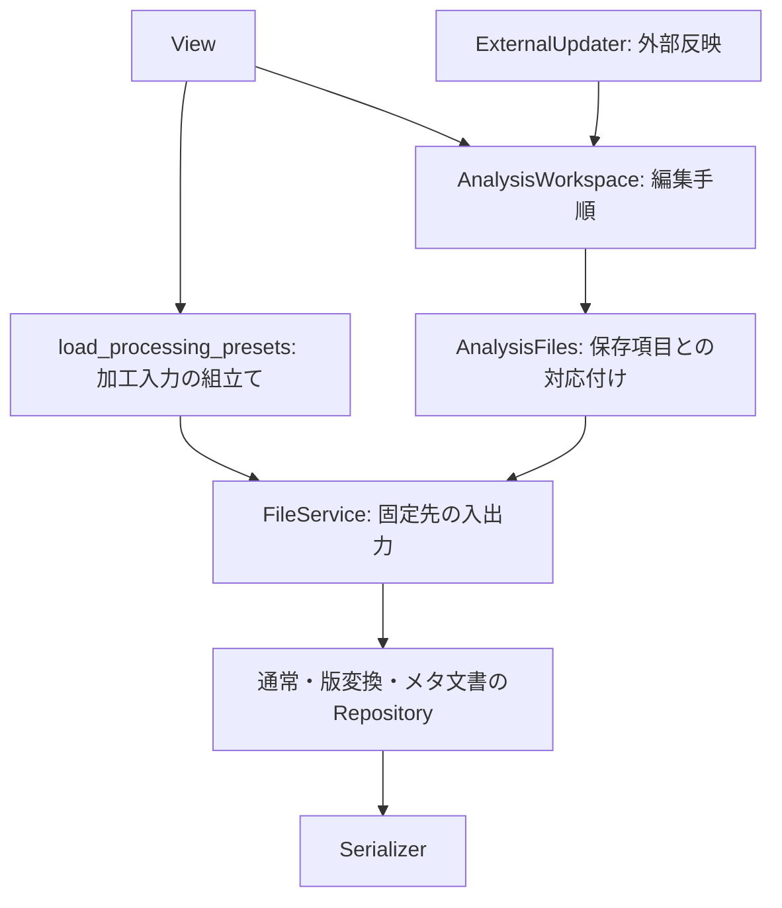

# 名前から役割と呼び方を類推する

ファイル操作、版変換、解析の編集管理、外部反映を、同じServiceという名前で一括りにしない構成へ整理しました。通常・版変換付き・メタ付きのファイルも、利用側では同じFileServiceのload/save/save_asで扱えます。

## 名前と責務

| 名前 | 担当 | 主な呼び方 |
|---|---|---|
| Serializer | 文字列・バイト列と値の変換 | loads / dumps |
| Repository | パスを受け取る入出力 | load(path) / save(path, value) |
| Versioned…Repository | Repositoryへ版変換を組み合わせる | load(path) / save(path, value) |
| FileService | 一つの通常のファイル入出力窓口 | load() / save(value) / save_as(path, value) |
| FileReader | 読取専用の窓口 | load() |
| FileWriter | 書込専用の窓口 | save(value) / save_as(path, value) |
| AnalysisWorkspace | 解析フォルダの編集権と、対象別の保存手順 | edit / save_settings / save_measurements / export_settings |
| ExternalUpdater | 保存済みデータの外部への反映・再試行 | refresh |

同じ役割には同じ引数順と操作名を使います。読み取ることのない帳票にloadを付けたり、解析一式の部分保存を一般的なsave一つへ押し込んだりはしません。

## 一般的な呼出側の規則

```python
value = file.load()
file.save(value, overwrite=True)
file.save_as("another.json", value)
```

保存先は構成時に固定します。save_asは通常の保存先を変更しません。相対パスは元のRepositoryのbase_directory基準です。通常の保存先の親へ自動的に付け足す処理はありません。既存ファイルを置換するには、どちらの保存でもoverwrite=Trueが必要です。

FileServiceが扱う読取型と書込型はRepositoryから別々に推論されます。listを読み、tupleを含むSequenceを保存できます。BaseModel、辞書、行一覧、メタ付き文書、維持項目を含むアプリ側の文書を同じ窓口へ構成できます。ModelBindingの対象を広げたり、FileServiceが各モデルの項目を解釈したりする変更ではありません。

```python
from pathlib import Path
from DataManager import FileService, ObjectRepository, RowsRepository
from examples.application_services import ApplicationSettings, MeasurementRecord

directory = Path("data")
settings = FileService(
    repository=ObjectRepository(model=ApplicationSettings, base_directory=directory),
    path="settings.yaml",
)
measurements = FileService(
    repository=RowsRepository(model=MeasurementRecord, base_directory=directory),
    path="measurements.csv",
)

# settings.load()はApplicationSettings、measurements.load()はlist[MeasurementRecord]。
```

汎用の基本窓口は、型を持つ小さなProtocolでRepositoryへ委譲します。実装の基底クラスや、メソッド名を実行時に探す仕組みは要求しません。FileServiceはSerializerのオプションや版の既定値を複製しません。

## メタ付きもload/save

```python
from DataManager import FileService, RowsDocumentRepository, RowsRepository
from examples.metadata import FileMetadata, Measurement

document_file = FileService(
    repository=RowsDocumentRepository(
        repository=RowsRepository(model=Measurement, base_directory=directory),
        metadata_model=FileMetadata,
    ),
    path="measurements.jsonl",
)
document = document_file.load()
document.metadata.version
document.rows
document_file.save_as("measurements-copy.jsonl", document)
```

メタの復元型を構成時に決めるため、利用側で毎回load_documentへ呼び分けたり、metadata_modelを指定し直したりする必要がありません。RowsDocumentRepositoryは既存のload_document/save_documentへ委譲する小さなアダプターです。Repositoryを直接使うload_document / save_documentも通常・版付きで同じ呼び方です。版付きRowsのload / saveは行一覧を扱います。[移行方法](INTERFACE_CONSISTENCY.md)を参照してください。

## 版変換も同じ窓口

```python
from DataManager import FileService
from DataManager.settings_versions import create_settings_repository

repository = create_settings_repository(directory)
current_file = FileService(repository=repository, path="settings.yaml")
legacy_file = FileService(repository=repository.for_version(2), path="settings-v2.json")

document = current_file.load()
current_file.save(document, overwrite=True)
legacy_file.save(document)
```

for_versionは出力用の構成を新しく作り、元のRepositoryの設定を変更しません。どの構成でも読込は現在の型へupcastします。版の違いでFileServiceの引数を増やさず、保存方針を一度構成してから共通の操作を呼びます。

Repositoryを直接使う必要がある場合は、従来どおりsave(path, value, target_version=...)も使えます。版ごとのモデルや専用Serviceクラスを作る必要はありません。

## 読取専用・帳票

FileReaderにはsaveがなく、FileWriterにはloadがありません。例えば、帳票はReportRepositoryをFileWriterへ渡します。

```python
from DataManager import FileWriter
from DataManager.report_repository import ReportRepository

report = FileWriter(repository=ReportRepository(directory), path="report.csv")
report.save(rows)
report.save_as("report.xlsx", rows)
```

CSV/JSONL/Excelの違いはReportRepositoryが担当します。入力データの集約・明細生成はDomain/UseCaseに残し、FileWriterへ解析処理を入れません。

テンプレートを固定するObjectFileService、一覧のappendを使うRowsFileService、波形のpeekを使うWaveformFileServiceも残しています。これらの基本操作も同じ命名に揃え、追加機能を使うときだけ選びます。JSONL追記や波形peekをすべてのファイルへ無理に追加しません。

## 加工・解析・外部反映の境界

計算と編集の反映は別操作です。`analyze_readings(presets)`で計算し、`apply_analysis_result(presets, result)`で反映します。手順は[全工程の例](WORKFLOW.md)を参照してください。

加工入力の組立てはUseCase.processing.load_processing_presetsへ移しました。AnalysisWorkspaceは編集権、保存済み一式の読込、変更したファイルの保存に集中します。



```python
with workspace.edit() as presets:
    presets.threshold = 12
    workspace.save_settings(presets, overwrite=True)
    workspace.export_settings("settings-v2.json", presets, target_version=2)
```

設定だけの保存で測定ファイルを更新しないことは維持しています。別出力はexport_settingsへ分け、通常のsettings.yamlを旧版で置換する指定は拒否します。加工・解析のPresetsは直接渡し、管理オブジェクト越しの多段参照を増やしません。

## 呼出側の移行

| 以前 | 現在 |
|---|---|
| VersionedObjectService / VersionedRowsService | VersionedObjectRepository / VersionedRowsRepository |
| create_settings_service | create_settings_repository |
| AnalysisService | AnalysisWorkspace |
| analysis.load_processing(path, values) | load_processing_presets(path, values) |
| analysis.save_settings(presets, path=..., target_version=...) | workspace.export_settings(path, presets, target_version=...) |
| ExternalUpdateService / application=... | ExternalUpdater / workspace=... |
| ReportExportService.export(path, rows) | FileWriterのsave/save_as、またはReportRepository.save(path, rows) |

旧クラス名・ファクトリー名は移行用の別名を残しています。ReportExportServiceは互換モジュールから新しい担当へ委譲します。ただし、移動した加工入力メソッド、別出力のsave_settingsの旧引数、外部更新のコンストラクタのキーワードは上表の移行が必要です。旧APIを新しい窓口に全て追加し直す対応はしていません。

今回の整理では保存データの文法・業務版・排他方式を変更していません。Pythonの役割分担と呼出側の整理なので、それだけを理由に業務データの版を更新しません。

実行する場合は、プロジェクトのルートで`python -m examples.application_services outputs/file-example`、`python -m examples.metadata outputs/document-example`を使います。既存出力先は上書きせず、新しい保存先を指定してください。

YAMLのテンプレート指定・既存内容・版別出力と、Rowsのmeta変換の接続は[テンプレートと版変換](TEMPLATES_AND_VERSIONS.md)を参照してください。
