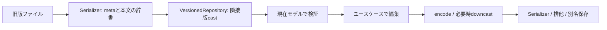

# 追加ヘッダ・空白区切り・版変換の使い方

## 最初に見る実行例

プロジェクト直下から、未作成の出力先を指定します。インストールやsrcは不要です。

```powershell
python -m examples.versioned_object outputs/versioned_object
python -m examples.versioned_rows outputs/versioned_rows
python -m examples.text_headers outputs/text_headers
```

- `versioned_object.py`：Serializer → ObjectRepository → VersionedObjectRepository → FileServiceの構成を一か所で示します。旧版を読んで現在モデルで編集し、現在YAMLと別名のV2へ保存します。テンプレートは保存先とは別のディレクトリです。
- `versioned_rows.py`：旧CSVのmetaと本文を一緒にupcastし、現在JSONL・旧CSVへ保存します。モデル生成はキャスト完了後です。
- `text_headers.py`：複数key:valueのヘッダと空白本文を読み、同じRowsDocumentを追加ヘッダ付きブロックへ保存します。



## YAMLの維持項目を末尾へ配置する

```python
YamlSerializer(dump_options=YamlDumpOptions(footer_fields=("retained_values",)))
```

テンプレート・既存文書・保存値を統合した後で、指定した最上位キーを末尾へ移し、その前に空行を入れます。`create_settings_repository()`はこの設定を組み込み済みです。サンプルで使っている項目名は複数形の`retained_values`です。実モデルの名前が`retained_value`なら、その名前を指定できます。

```yaml
version: 4
threshold: 15.0
gain: 1.0
generate_output: false

retained_values:
  operator_note: keep
```

指定していない通常のYamlSerializerの順序規則は従来どおりです。存在しないキーを作ったり、版変換で捨てたキーを復活させたりはしません。末尾に指定した項目の独立コメントは空行の後ろへ残します。直前がブロック文字列の場合は文字列の改行を守ることを優先するため、空行追加を保証しません。

## CSVのセル区切りとヘッダ区切り

`delimiter=" "`で本文を半角スペース区切りにします。連続スペースも読めます。引用された空セルは保持し、空白を含む値・空セルは保存時に引用します。入力だけ別の区切りにするなら、read_options=CsvOptions(delimiter=...)を指定します。

`field_separator="."`は`position.x`のような入れ子のキーを作るための設定です。列の区切りとは用途が違うので、その意味を変更していません。

```python
CsvSerializer(
    options=CsvOptions(delimiter=" "),
    metadata=CsvKeyValueHeaderOptions.until_marker("[data]").as_text(multiple=True),
)
```

```text
version: 4    device: A001
saved_at: "2026-11-09 12:30:00"
[data]
name    value
A    1.25
```

- `CsvKeyValueHeaderOptions.separator=None`（既定）：従来の2セルのCSVメタ。本文と同じdelimiterを使います。
- `separator=":"`：コロン前後のスペースを許容します。`" "`ならkeyとvalueも空白区切りです。
- `multiple=False`（既定）：一行一対。区切りの後ろ全体が値なので、日時の空白や値内のコロンを保持します。
- `multiple=True`：一行に複数対を読めます。値に空白がある場合はJSON文字列として二重引用符で囲みます。引用内のバックスラッシュ等はJSONのエスケープ規則です。引用しないWindowsパスやURLのコロンは値の一部です。
- `prefix="# "`：各meta行に接頭辞がある形式向けです。境界マーカーには接頭辞を付けず、設定文字列そのもので比較します。

保存は一対一行に揃え、値を引用します。元のスペース数や一行内の配置は再現しません。メタの値は文字列として読み、数値・日時の変換には`metadata_model`を指定します。テキストヘッダの`fixed_rows`は**物理行数**です。従来のCSVメタは引用符内改行を含むCSVレコード数です。

空の値を複数対の行へ手書きする場合は`key: ""`と書いてください。曖昧な区切りを推測しません。本文の空セルも`""`で表し、複数スペースだけで空セルの位置を表現しないでください。

## ブロックの列名とは別に、ファイル全体のヘッダを扱う

`BlockRowsRepository`という専用クラスを追加せず、既存の`RowsRepository + BlockRowsSerializer`へ揃えています。

```python
BlockRowsOptions(
    rows=(BlockRow.root("name", "value"),),
    metadata=CsvKeyValueHeaderOptions.until_marker("[columns]").as_text(multiple=True),
)
```

```text
version: 4    device: A001
[columns]
# name;value
#
A;1.25
#
```

metadataで指定した終端より前が追加ヘッダ、その後が従来の列定義・レコードです。本文の`marker="#"`とは別に境界を設定するので、ヘッダと列名を取り違えません。メタの接頭辞も共通のヘッダ設定へ指定します。

```python
document = repository.load_document("capture.blocks")
print(document.metadata["device"])
document.metadata["device"] = "A002"
repository.save_document("export.blocks", document)
```

型付きmetaは`load_document(..., metadata_model=CaptureMetadata)`を使います。FileServiceで扱うなら`RowsDocumentRepository(repository=repository, metadata_model=CaptureMetadata)`を接続します。`load()`は行だけを返すので、追加ヘッダを保存したい場合は文書APIを使ってください。設定なしの既存ブロック形式にmetaを勝手に追加しません。

## VersionedRowsのmodels

```python
JsonlSerializer.for_dict(document_models=("Reading",))
```

VersionedRowsRepositoryの生Repositoryは`model=dict`です。現在モデルで読むと、upcast前に旧キーが除外・拒否されるためです。任意の`decode_current`関数から復元先クラスを安全に推測できないので、dict文書の論理名をSerializerへ明示します。通常のモデルRepositoryでは従来どおりモデル型から自動で記録されます。

```json
{"__meta__":{"schema_version":2,"mode":"dict","models":["Reading"]},"metadata":{"instrument":"A001","version":1}}
```

`document_models`はクラスを動的importするための名前ではなく、異なる種類のファイルを誤読しないための固定識別名です。長期保存ではPythonクラス名の変更に合わせて変えない名前を選べます。複数種類なら複数の名前を指定できますが、行ごとの型判定は既存のdecode_current側で明示します。空の行一覧でも同じ名前を記録します。

利用者の`metadata`は本文と一緒にupcast/downcastされます。一方、`__meta__`はJSONLの形式照合用で、業務cast対象ではありません。`schema_version`も業務データのversionとは別です。

既存の`models: []`のdictファイルと、名前を指定したファイルは厳密照合で区別します。既存ファイルは名前未指定の旧構成で一度読み、名前付きの新構成で**別名へ保存**して移行できます。今回のサンプルは入力用CSVからこの名前付き構成へ保存します。名前設定を変えただけで既存JSONLを読めると想定しないでください。


CSV設定の全項目・条件とa〜gの例は[CSV設定ガイド](CSV_OPTIONS.md)を参照してください。
