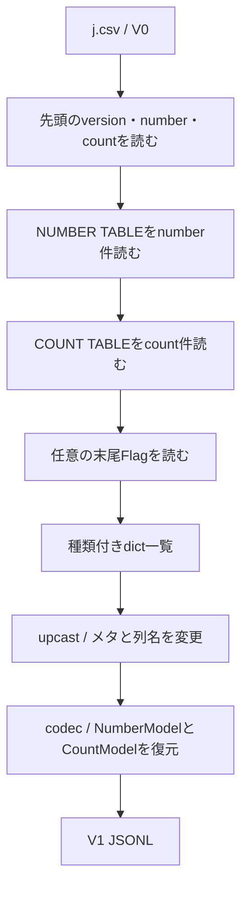

# j.csv：二つの表・末尾Flag・混在JSONL

実際の`examples/csv_data/j.csv`を対象にした専用Serializerです。
`NumberCountCsvSerializer`がV0の配置、castが列名・メタ名の変更、
VersionedRowsRepositoryのcodecが現在モデルへの復元を担当します。
共通CsvOptionsやTwoTableCsvSerializerは変更していません。

## 実行例

```console
python -m examples.number_count_csv outputs/number-count-csv
```

`examples/number_count_csv.py`を次の順で読めます。

| 定義 | 役割 |
|---|---|
| NumberModel / CountModel / TableMetadata | 現在版の型 |
| upcast_v0_to_v1 | NUMBERINDEX等とFlagを現在名へ変換 |
| downcast_v1_to_v0 | V0の名前へ戻し、NoneのFlagを除外 |
| create_repository | V0専用CSV・V1 JSONL・cast・モデル登録を接続 |
| make_document | 編集後のnumber/countを一か所で更新 |
| sample_roundtrip | j.csv→V1 JSONL→V0への別名保存 |
| sample_optional_flag | FlagなしとFlag=0の違い |
| sample_edited_counts | COUNT追加後のJSONL・CSV出力 |

各sample関数は独立した例です。CLIは三つを順に実行し、計6ファイルを出力します。
入力j.csvは上書きせず、元のバイト列が変わらないことも確認します。

## 読み込みの流れ



前置の# sampleなどの説明コメントと空行は読み飛ばします。
表名と列名は#付きで、NUMBER TABLE→COUNT TABLEの順を要求します。
COUNTの見出しはorder,valueですが、データの3項目をindex,order,valueとして扱います。
indexは実際のファイルの値で、連番を生成しません。number/countは件数であり、indexやorderの最大値ではありません。
V0のNAMEは文字列、その他のデータ列は整数です。

表内はCSVの**論理レコード**で数えます。引用符内の改行・空行やFlagという文字列を、
表の境界や末尾メタとして解釈しません。件数不足、余剰データ、不正な列名・列数はエラーです。

## V1の型とJSONL

```python
model_tags: dict[type[NumberModel | CountModel], str] = {
    NumberModel: "number",
    CountModel: "count",
}
```

この表をVersionedRowsRepository.for_modelsへ渡すと、JSONLのmodelsと行ごとのtype、
現在モデルの復元先が揃います。V0用のBaseModelを別に定義する必要はありません。

```json
{"type":"number","index":0,"id":1,"name":"taro yamada"}
{"type":"count","index":1,"order":1,"value":2}
{"type":"count","index":2,"order":3,"value":4}
```

先頭の形式メタのmodelsは`["count", "number"]`です。
利用者メタにはversion・number・count・flagを保存します。形式メタとは別です。

## Flagと空白

- V0のFlagはメタとして返し、V1ではupcastでflagへ改名。
- 現在モデルのflagがNoneなら、V0へ出すFlagは省略。
- 0は明示的な値なので`Flag: 0`を末尾へ出力。
- JSONLのflag=Noneはnullとして保持し、V0での省略と区別せずに往復可能。
- カンマ直後の書式用スペースを除去し、引用符内と名前内部の空白は保持。

CSV出力では文字列を引用して、意図的な先頭空白も再読時に失わないようにしています。
元の説明コメント・空白配置・引用表現をそのまま保存する処理はありません。
Flagは既知の整数項目一つとして扱い、汎用FooterOptionsなどは追加していません。
Flagの重複や後続の余分な内容はエラーです。

## 保存時の整合性

```python
document = make_document(edited_rows, flag=current_document.metadata.flag)
repository.save("edited.jsonl", document)
repository.for_version(0).save("edited.csv", document)
```

make_documentはこの実行例の「保存する文書の組み立て」です。
アプリケーションでは、同じ役割の処理をUseCase側へ置けば、どの出力にも一貫した件数を渡せます。
CSVのSerializerは不一致を黙って修正せず、メタと実際の行数が違えば保存前に止めます。
V0 CSVへ出すときは、number/countで振り分け、各表の内部の順序を保持します。
JSONLで二種類を交互に並べていても、V0では必ずNUMBER→COUNTの順になります。

ファイルIO・ロック・アトミック保存・上書き保護は既存Repositoryの担当です。
専用Serializerに現在モデルやアプリケーションのファイル操作を埋め込んでいません。
V1を.csvへ直接出す形式ではないため、旧CSVへの出力にはfor_version(0)を明示します。

見本：[V1 JSONL](../sample_outputs/number_count_csv/current.jsonl)、[V0 CSV](../sample_outputs/number_count_csv/export_v0.csv)、[Flagなし](../sample_outputs/number_count_csv/without_flag.csv)、[Flag=0](../sample_outputs/number_count_csv/flag_zero.csv)、[編集後JSONL](../sample_outputs/number_count_csv/edited.jsonl)、[編集後V0](../sample_outputs/number_count_csv/edited_v0.csv)。
