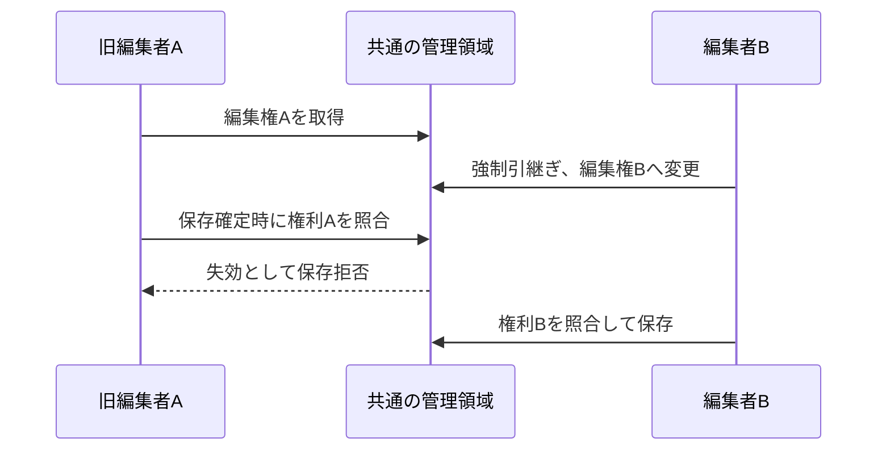

# Windows/Linuxの共有保存領域と強制引継ぎ

対象は、同じ共有フォルダ上の解析データを複数の対応クライアントが編集する運用です。コードはOS依存のPID操作を行わずPortalockerを使います。今回の動作確認はWindowsのローカルファイルシステムです。実際のSMB・Linuxからの接続を検証済みとは扱いません。

## 保存領域を一度だけ初期化する

```python
from pathlib import Path
from DataManager import Storage

# 保守操作として、全クライアントを止めて一度だけ実行する。
Storage.initialize(Path("共有データのルート"))
```

```text
共有データのルート/
├── storage.json
├── application_control/
│   ├── guards/       # file/editor各32、合計最大64の固定ガード
│   └── editors/      # 編集中・異常終了後に残った対象の情報だけ
└── datasets/
    ├── sample01/
    └── …
```

アプリのインストール先や版ごとに管理場所を指定しません。Storage.discover(対象フォルダ)で親のstorage.jsonを見つけ、固定のapplication_controlへ到達します。未設定・破損・非対応プロトコル・管理フォルダ欠落はエラーです。解析開始時に別の管理領域を自動作成しません。入れ子の保存領域の初期化も拒否します。

storage.jsonの管理プロトコルはアプリのリリース番号とは別です。同じプロトコルのアプリは同じ固定規則を使います。この方式を持たない旧版は、導入時に停止・更新してください。領域の移転・識別情報の復元も全クライアント停止中の保守操作です。

対象IDは保存領域からの相対パスと保存領域IDから決め、端末ごとのドライブ名を含めません。Windows主体の共有を想定し、大小文字だけ違う名前は保守的に同じ対象として扱います。大小文字だけで異なる解析フォルダを使わないでください。

## 編集と保存

```python
from pathlib import Path
from UseCase.analysis import AnalysisWorkspace

service = AnalysisWorkspace(Path("共有データのルート/datasets/sample01"))
with service.edit() as presets:
    presets.threshold = 12
    service.save_settings(presets, overwrite=True)

# 所有者と対象を確認したうえで、操作者が明示する。
with service.edit(force=True) as presets:
    presets.threshold = 15
    service.save_settings(presets, overwrite=True)
```

所有者情報には利用者・端末・PID・開始時刻・一意なセッションIDを収録します。PIDや経過時間だけで自動解除しません。Storage.editor(path)で表示用の情報を取得できます。強制引継ぎは他端末のプロセスを終了させず、編集権を新しいセッションへ入れ替えます。



解析中にOSロックを保持し続けません。ファイルの重い生成・一時ファイルへの書出しの後で、短時間の編集ガード中に権利を検証し、そのまま置換します。権利確認だけを先に行ってから無防備に保存する構成ではありません。JSONL追記は直接書込区間を保護します。保存区間そのものがハングしたときまで、安全に追い越せるとは保証しません。

旧編集者の終了処理も、自分のセッションIDと一致するときだけ情報を削除します。引継ぎ先の所有者情報を旧処理が削除することを防ぎます。

## ファイル数と後始末

数千フォルダを事前登録せず、指定対象の情報だけを参照します。ガードは必要になったものだけ最大64個まで作り、待機者と対象が分裂しないよう管理領域に残します。通常終了するとeditors内の自分の所有者情報を削除します。

異常終了では所有者情報が残る場合があります。これはOSロックの残存ではなく、確認・明示引継ぎのための記録です。force=Trueで引継ぎます。壊れた管理情報やI/Oエラーを、空の所有者情報だと解釈して編集を許可しません。

単独Repositoryを保存領域外で使う場合は、親の.data_manager_locksへ固定数のファイルI/Oガードを置きます。この経路はフォルダの編集権を提供しません。共有の解析処理は初期化済みStorageとAnalysisWorkspaceを使ってください。保存領域内ではこの隠しフォルダを各解析フォルダへ作りません。

## 保証する範囲

- アプリの解析データ保存はAnalysisWorkspace→AnalysisFiles→Repositoryを通し、保存確定時のcommit_guardを適用します。独自の保存窓口にも同じセッションのcommit_guardを注入してください。
- ロック規約を通らない旧アプリ、直接のファイル操作やテキストエディタまで遮断するアクセス制御ではありません。
- 初回保存の後始末も編集権を確認します。引継ぎ後に旧処理がファイルを削除しない代わりに、途中の一式が残る場合は確認・復旧が必要です。
- 保存はファイル単位です。複数ファイルの一括コミットや、外部DB/集約情報まで含むトランザクションは提供しません。
- SMBサーバ・Linuxのマウント設定に依存するため、本番では別端末からの競合・引継ぎ・切断・復帰・保存拒否・原子的置換を確認してください。接続先へ未確認の操作を自動実行する機能はありません。

例は`python -m examples.shared_editing outputs/shared`です。ローカルで二つのサービスを別クライアント相当として動かします。

Windowsのドライブ割当やLinuxのマウントは、storage.jsonへ到達できる共有ルートを含むよう設定してください。解析サブフォルダだけをマウントしてマーカーが見えない場合、編集開始はエラーになります。

この方式は対応クライアントの保存時検証であり、ファイルサーバ自身がセッションIDを検証する仕組みではありません。ネットワーク分断をまたぐ厳密な書込保証が必要なら、保存確定をサーバ側へ集約する方式を別途検討します。
