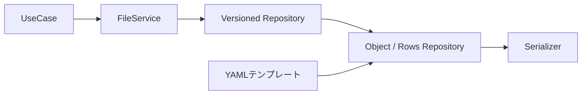
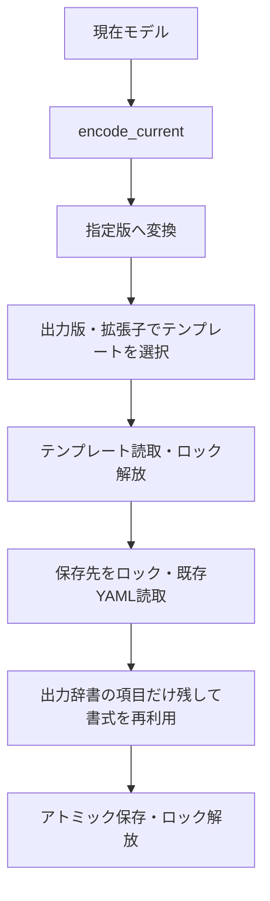

# FileService・版変換・YAMLテンプレート

FileServiceは対象パスを固定し、版変換はVersioned…Repository、ファイル操作は通常のRepository、文法はSerializerへ委譲します。Rowsにテンプレートは追加していません。



## YAMLの構成

```python
from pathlib import Path
from DataManager.services import FileService, FileWriter
from DataManager.settings_versions import create_settings_repository

repository = create_settings_repository(
    Path("D:/analysis/data"),
    template_directory=Path("C:/application/templates"),
    templates_by_version={
        3: {".yaml": "settings_v3.yaml"},
        2: {".yaml": "legacy/settings_v2.yaml"},
    },
)
file = FileService(repository=repository, path="sample01/settings.yaml")
document = file.load()
document.settings.threshold = 15
file.save(document, overwrite=True)

legacy = FileWriter(repository=repository.for_version(2), path="exports/settings_v2.yaml")
legacy.save(document)
```

保存先とテンプレートは別ドライブ・別の共有フォルダーでも指定できます。テンプレート名はtemplate_directory内の相対パスです。ディレクトリ外への指定と保存先自身の指定は拒否します。

templates_by_versionは「出力版→拡張子→テンプレート名」です。拡張子も指定するため、同じRepositoryからJSONへsave_asしてもYAMLテンプレートは使いません。.ymlを使う場合はその拡張子も登録します。ある拡張子のテンプレートを登録した場合、その拡張子で出す版には対応する登録が必要です。未登録の版へ別版のテンプレートを流用しません。

版変換のないObjectRepositoryでは、template_directoryとtemplate_nameを構成時に固定できます。そのままFileServiceへ渡せます。直接saveへtemplate_nameを渡す従来の指定も使えます。

## 保存順と値の決定



| 文書 | 値とキーの扱い |
|---|---|
| 通常のObjectRepository | テンプレート→既存文書→モデル値の順で合成。未指定のキーも残る |
| VersionedObjectRepository | encodeとcastが確定した項目・値だけを保存。テンプレート・既存文書から廃止キーを復活させない |

版変換付き保存のテンプレートは、存続するキーのコメント・キー順・引用符に利用します。旧版の必須値や既定値はdowncastで用意します。テンプレートだけに存在する値で、版変換結果の不足を補いません。配列の要素単位のコメント移植や、改名したキーのコメントの自動対応は行いません。

existing_textは「今回の保存先の内容」、template_textは「テンプレートの内容」です。どちらもRepositoryが読み、Serializerへ渡します。UseCaseから生の文字列を渡す必要はありません。save_asでは元の読込ファイルではなく別出力先がexisting_textの対象です。

通常の直接保存で同じ制御が必要なら、merge_existing=Falseで出力項目を限定し、preserve_existing_comments=Trueで存続キーの既存コメントを引き継ぎます。版変換付き保存ではこの二つを内部で指定します。

## Rowsのmetaと本文

```text
読取 → {version, metadata, rows} → upcastの連鎖 → 現在モデル
現在モデル → encode_current → {version, metadata, rows} → downcast → 保存
```

キャストはmetaと本文を一緒に受け取ります。metaのキー変更・補完・廃止、metaの値に応じた本文の変換もその関数で記述します。途中のcastで参照する版は文書直下のversionです。入出力の境界で、その版をmetadata.versionへ揃えます。JSONLの内部schema_versionとは別の番号です。

FileServiceには通常と同じload/save/save_asを提供します。返却型はdecode_currentの返却型で決まり、metaを型付きで扱うならRowsDocument[Meta, Row]に復元します。CSVの版が文字列ならread_versionで整数へ解釈します。出力版の選択はrepository.for_version(n)です。

Rowsの文書テンプレート機能は設けていません。CSVの境界・列定義はCsvOptions、JSONLのmeta生成はJsonlSerializerが担当します。ブロック形式の列ヘッダーはファイルmetaとは別物であり、版番号の保存位置が定義されていない形式にmeta行を勝手に追加しません。

## 属性行を持つブロック

BlockRowsFormatはレコード内の行を保持します。BlockRowsSerializerは平坦なモデル用、AttributeBlockSerializerは「本体4列・属性8行各4列・寸法2列」をattrs付きモデルへ対応付けます。AttributeBlockSerializerの既定の寸法キーはstart_mm/length_mmです。

```python
repository = RowsRepository(
    model=BlockModel,
    base_directory=Path("data"),
    serializers_by_extension={".txt": AttributeBlockSerializer()},
)
file = FileService(repository=repository, path="blocks.txt")
models = file.load()
```

異なる行のstart/lengthは別の辞書へ入れ、同じ行の重複は拒否します。attrsが8件でない保存は失敗します。別の固定件数はattribute_count、位置を変えずに列名を置換するときはBlockRowsOptions.columnsを指定します。別の行構造には、共通の文法処理へ委譲する専用Serializerを追加します。

## 実行例

`python -m examples.versioned_files outputs/versioned-files`で、別置きの版別YAMLテンプレート、CSVとJSONLをまたぐmeta・本文の双方向変換、属性8行の保存と再読を確認できます。出力見本はsample_outputs/versioned_filesです。

PositionalCaptureReaderはPositionalCaptureSerializerへ改名しました。位置から旧キーを付ける読取専用の架空例で、実業務の形式は対応付けを置き換えてください。
