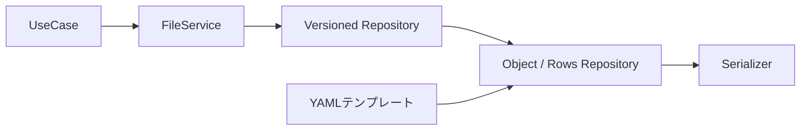
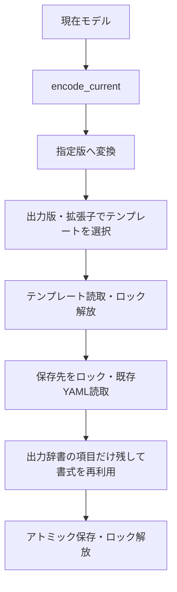

# FileService・版変換・YAMLテンプレート

FileServiceは対象パスを固定し、版変換はVersioned…Repository、ファイル操作は通常のRepository、文法はSerializerへ委譲します。Rowsにテンプレートは追加していません。



## YAMLの構成

```python
from pathlib import Path
from DataManager.services import FileService, FileWriter
from DataManager.settings_versions import create_settings_repository

repository = create_settings_repository(
    Path("D:/analysis/data"),
    template_directory=Path("C:/application/templates"),
    templates_by_version={
        4: {".yaml": "settings_v4.yaml"},
        2: {".yaml": "legacy/settings_v2.yaml"},
    },
)
file = FileService(repository=repository, path="sample01/settings.yaml")
document = file.load()
document.settings.threshold = 15
file.save(document, overwrite=True)

legacy = FileWriter(repository=repository.for_version(2), path="exports/settings_v2.yaml")
legacy.save(document)
```

保存先とテンプレートは別ドライブ・別の共有フォルダーでも指定できます。テンプレート名はtemplate_directory内の相対パスです。ディレクトリ外への指定と保存先自身の指定は拒否します。

templates_by_versionは「出力版→拡張子→テンプレート名」です。拡張子も指定するため、同じRepositoryからJSONへsave_asしてもYAMLテンプレートは使いません。.ymlを使う場合はその拡張子も登録します。ある拡張子のテンプレートを登録した場合、その拡張子で出す版には対応する登録が必要です。未登録の版へ別版のテンプレートを流用しません。

版変換のないObjectRepositoryでは、template_directoryとtemplate_nameを構成時に固定できます。そのままFileServiceへ渡せます。直接saveへtemplate_nameを渡す従来の指定も使えます。

## 保存順と値の決定



| 文書                      | 値とキーの扱い                                                                             |
| ------------------------- | ------------------------------------------------------------------------------------------ |
| 通常のObjectRepository    | テンプレート→既存文書→モデル値の順で合成。未指定のキーも残る                             |
| VersionedObjectRepository | encodeとcastが確定した項目・値だけを保存。テンプレート・既存文書から廃止キーを復活させない |

版変換付き保存のテンプレートは、存続するキーのコメント・キー順・引用符に利用します。旧版の必須値や既定値はdowncastで用意します。テンプレートだけに存在する値で、版変換結果の不足を補いません。配列置換で失われるキー直前の空行と独立した節コメントは、パーサーのキー位置を使って補います。ブロック文字列の末尾の空行は値の一部なので区切りとして補いません。配列の要素単位のコメント移植や、改名したキーのコメントの自動対応は行いません。

existing_textは「今回の保存先の内容」、template_textは「テンプレートの内容」です。どちらもRepositoryが読み、Serializerへ渡します。UseCaseから生の文字列を渡す必要はありません。save_asでは元の読込ファイルではなく別出力先がexisting_textの対象です。

通常の直接保存で同じ制御が必要なら、merge_existing=Falseで出力項目を限定し、preserve_existing_comments=Trueで存続キーの既存コメントを引き継ぎます。版変換付き保存ではこの二つを内部で指定します。

## Rowsのmetaと本文

```text
読取 → {version, metadata, rows} → upcastの連鎖 → 現在モデル
現在モデル → encode_current → {version, metadata, rows} → downcast → 保存
```

キャストはmetaと本文を一緒に受け取ります。metaのキー変更・補完・廃止、metaの値に応じた本文の変換もその関数で記述します。途中のcastで参照する版は文書直下のversionです。入出力の境界で、その版をmetadata.versionへ揃えます。JSONLの内部schema_versionとは別の番号です。

FileServiceには通常と同じload/save/save_asを提供します。返却型はdecode_currentの返却型で決まり、metaを型付きで扱うならRowsDocument[Meta, Row]に復元します。CSVの版が文字列ならread_versionで整数へ解釈します。出力版の選択はrepository.for_version(n)です。

Rowsの文書テンプレート機能は設けていません。CSVの境界・列定義はCsvOptions、JSONLのmeta生成はJsonlSerializerが担当します。ブロック形式の列ヘッダーはファイルmetaとは別物であり、版番号の保存位置が定義されていない形式にmeta行を勝手に追加しません。

## 属性行を持つブロック

BlockRowsFormatは文法と行の境界、BlockRowsSerializerはモデルの対応付けを担当します。平坦な形式とattrsを持つ形式を同じSerializerで扱います。

```python
columns = (
    ("name", "ch", "start", "length"),
    *(("name", "value", "start", "length"),) * 8,
    ("start_mm", "length_mm"),
)
options = BlockRowsOptions(
    delimiter=",", columns=columns,
    row_targets=(None,) + ("attrs",) * 8 + (None,),
)
repository = RowsRepository(
    model=BlockModel, base_directory=Path("data"),
    serializers_by_extension={".txt": BlockRowsSerializer(options=options)},
)
file = FileService(repository=repository, path="blocks.txt")
models = file.load()
```

| 設定           | 役割                                                               |
| -------------- | ------------------------------------------------------------------ |
| columns        | 各行の値を復元するモデルのキー。指定時は入力の列名を位置で置換する |
| row_targets    | Noneならモデル直下、名前を指定するとその一覧へ一行ずつ追加する     |
| header_columns | 保存する見出しを別名にする場合だけ指定する。省略時はcolumnsを使う  |

属性行のstart/lengthは各属性の辞書へ入ります。同じ行の重複、モデル直下のキー同士・一覧名との衝突は拒否します。例ではattrsに対応する行が8本あるため、保存時のattrsも8件を要求します。別の件数や複数の一覧も同じ指定方法で扱えます。途中の属性行を増減して黙って補正することはありません。

ファイル上の見出しがinfo_name1/info_value1でも、columnsをname/valueに置換して復元できます。元の見出し名で保存する場合はheader_columnsにファイル上の列名を指定します。詳細はexamples/versioned_files.pyのblocks_exampleを参照してください。

AttributeBlockSerializerは移行用ファクトリーとして残し、BlockRowsSerializerを構成して返します。新規の呼出と例は統合先へ揃えています。ゼロ件の一覧には対応するデータ行がないため、この旧窓口は1件以上を指定します。データ行を持たない0件の一覧を宣言する機能は現在のrow_targetsにはありません。

## V3以前の作成フラグ

このサンプルの設定はV4です。V3以前は作成制御がなかったため、V3→V4でgenerate_output=Trueを補完します。隣接ファイルが欠けていてもFalseにはしません。V4のFalseは設定読取→加工Presets→解析Presets→保存を通じて維持します。

```text
旧設定を読む → 隣接版のcastでTrueを補完 → 現在モデルで検証 → Presetsへ渡す
V4を読む   → 保存されたTrue/Falseを採用 → 現在モデルで検証 → Presetsへ渡す
```

generate_outputは生成の指示で、生成物の有無とは別の値です。確認用のis_file等はAnalysisFilesのようなアプリ固有の読込担当へ置きます。汎用Repositoryやcastの中へ特定ファイルの探索を持ち込みません。

例ではUseCase相当の処理がoptional_result.txtの作成を判断します。実業務ではその生成対象を置き換えてください。V3/V2へのdowncastはこのフラグを除外するため、旧システム側は従来どおり常に作成します。

## 実行例

`python -m examples.versioned_files outputs/versioned-files`で、別置きの版別YAMLテンプレート、CSVとJSONLをまたぐmeta・本文の双方向変換、属性8行の保存と再読、V3からのTrue補完とV4のFalse保持を確認できます。出力見本はsample_outputs/versioned_filesです。

PositionalCaptureReaderはPositionalCaptureSerializerへ改名しました。位置から旧キーを付ける読取専用の架空例で、実業務の形式は対応付けを置き換えてください。


追加ヘッダ・半角スペース区切り・modelsの設定と単独の版変換例は、[ヘッダと版変換の実行例](HEADERS_AND_SAMPLES.md)を参照してください。
