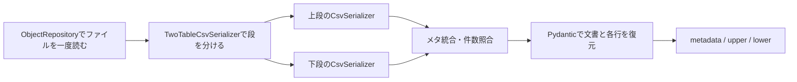

# AA・AAA：メタが分散した二段CSV

## 読むサンプル

```powershell
python -m examples.two_table_csv outputs/tables
python -m examples.two_table_csv outputs/aa --pattern AA
python -m examples.two_table_csv outputs/aaa --pattern AAA
```

examples/two_table_csv.pyのsample_aa / sample_aaaに、各形式の設定・読込・保存・再読確認を分けています。元のexamples/csv_data/AA.csv・AAA.csvは変更しません。出力先は未作成のディレクトリを指定します。

## 担当を分ける



一つの文書を返すため、入口はRowsRepositoryではなくObjectRepositoryです。拡張子.csvにTwoTableCsvSerializerを登録するだけで、既存のFileService.load / save / save_asと、排他・アトミック保存を使えます。Repositoryを二つに分けて同じファイルを読み直しません。

二種類の行を平坦なmixed一覧へ混ぜず、upper: list[UpperRow] / lower: list[LowerRow]として保持します。行モデルは文書モデルで宣言します。CSV内のtypeタグや、Serializerへの行モデルの重複登録は不要です。

```python
class TablesDocument(BaseModel):
    metadata: dict[str, int]
    upper: list[UpperRow]
    lower: list[LowerRow]
```

metadataは各所から集めた値です。AAではversion・count・max_indexが先頭、numberが下段直前にあります。記載位置はSerializerのヘッダ設定が保持するため、利用側はdocument.metadata["number"]のように参照できます。dictの値はそのまま読み、例のモデルではintへ検証・変換します。

## 構成するもの

| 引数 | 担当 |
|---|---|
| upper_header / lower_header | 各段の前にある固定メタ。CsvHeaderOptionsを指定 |
| upper_options / lower_options | 各テーブルのCSV設定。省略時は通常のCsvOptions |
| upper_count_field | 上段件数を示すメタのキー。既定count |
| lower_count_field | 下段件数を示すメタのキー。既定number |

件数項目は、それぞれのheader.fieldsに含めます。メタを一か所へ集めるため、上下段で同じキー名は指定できません。このSerializerは空行で分かれる二表向けです。表の数が可変、別の終端記号、チャンネル数による構造変更などを自動推測する機能ではありません。

```python
serializer = TwoTableCsvSerializer(
    upper_header=CsvHeaderOptions(fields=(
        CsvHeaderField("version", separator=""),
        CsvHeaderField("count"),
        CsvHeaderField("max_index"),
    )),
    lower_header=CsvHeaderOptions(fields=(CsvHeaderField("number"),)),
    upper_options=CsvOptions(column_prefix="#", strip_column_names=True),
    lower_options=CsvOptions(column_prefix="#", strip_column_names=True),
)
repository = ObjectRepository(
    model=TablesDocument,
    base_directory=Path("data"),
    serializers_by_extension={".csv": serializer},
)
document = FileService(repository=repository, path="AA.csv").load()
```

上下段を分けるのは空のCSVレコードです。引用符内の空行を境界と見なして単純にsplitしません。count=2と上段2行、number=5と下段5行を照合します。負数・不正な件数・件数不一致・境界不足・不正な列数はエラーです。

max_indexは先頭に記録して保持します。現状は業務的な意味が未確定なので、下段の最大indexからの補完・補正・照合は行いません。必要な意味が確定したら文書モデルなどへ検証を追加できます。

## AAAの余分な末尾delimiter

AAAは先頭のmax_indexがなく、上下段の本文に余分な末尾カンマがあります。ヘッダfieldsからmax_indexを除き、両段のCsvOptionsへ次を指定します。

```python
CsvOptions(
    column_prefix="#", strip_column_names=True,
    allow_trailing_empty_columns=True,
)
```

この設定は普通のCsvSerializerでも使えます。既定はFalseです。指定時だけ、期待列数を超えた末尾セルがすべて空なら除きます。

| 3列を期待する場合 | 読取結果 |
|---|---|
| 1,taro,3 | 通常の3列 |
| 1,taro,3, | 余分な末尾空セルを除いて3列 |
| 1,taro, | 正当な3列目の空値を保持 |
| 1,taro,3,extra | 余分な非空値なのでエラー |
| 1,taro | 列不足なのでエラー |

列名行にはこの設定を適用しません。列名行にも空の列が付く形式は、columnsで名前を全面置換できます。メタ用のallow_paddingとも別の規則です。保存は余分な末尾セルを付けない通常のCSVへ揃えます。

AA・AAAの下段は「0, hoge, 32」のように値の前に空白があります。strip_column_namesは列名だけを整え、本文のnameにある先頭空白は保持します。数値型への変換はPydanticへ任せています。

## 編集して保存する

```python
document.upper[0].value = 10
output.save(document, overwrite=True)
```

行数を変える場合は、count / numberも明示的に更新します。不一致のまま保存するとエラーにし、メタを勝手に補正しません。元ファイルを残す場合はsave_asで別名へ保存してください。

保存時はmetaをfieldsの位置へ分配し、上下段を変換してから一つの文書へ連結します。全体を再読・検証した後でRepositoryへ渡すため、後半の変換で失敗して前半だけが書かれることはありません。テンプレート・部分マージ・元のスペース数の再現は対象外です。

0件の段を保存するときは、通常のdict CSVと同じく、その段のCsvOptions.columnsを指定してください。内部では現在モデルの検証前にdictとして表を扱うため、空の一覧から列名を推測しません。
