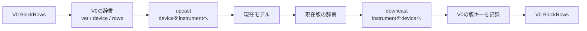

# 版付きRows：メタとモデルの登録

V0のBlockRowsとV1のJSONLを使う場合、形式を解釈するSerializerと、項目を移すcastを分けます。
実行例は `python -m examples.versioned_block_rows outputs/versioned-blocks`。
`sample_single_model`、`sample_unversioned_block`、`sample_mixed_models`を個別に読めます。

## 構成の入口

```python
repository = VersionedRowsRepository.for_models(
    repository=raw_repository,
    converter=converter,
    metadata_model=CaptureMetadata,
    model_tags={Reading: "reading"},
    metadata_version_fields={0: "ver"},
)
```

`raw_repository`は従来どおり`RowsRepository(model=dict, ...)`で、
`.blocks`へBlockRowsSerializer、`.jsonl`へJsonlSerializerを登録します。
`for_models`は登録表から現在モデルとの変換を構成し、JSONLのmodelsも自動で設定します。
元のRepositoryやSerializerを変更せず、保存先・ロック・commit_guardを保持した独立コピーを使います。

独自の現在文書への組み立てが必要な既存コードは、通常のコンストラクターで
`decode_current / encode_current`を指定する方式をそのまま利用できます。

## メタと版番号



upcast/downcastの対象は、内部の版番号・metadata・rowsを持つ一つのdictです。
メタの改名・補完・廃止と、本文の変更を同じcastで行います。
例えばV1の`instrument`は、V0へ出す前に`device`へ戻します。
V1だけの項目をV0へ持ち込むかどうかもcastで決めます。

版キーはRepositoryが管理します。内部の版はConverterのversion_fieldで扱い、
ファイルのメタへ書く名前は次のように指定します。

| 指定 | V0出力 | V1出力 |
|---|---|---|
| 未指定 | version: 0 | version: 1 |
| {0: "ver"} | ver: 0 | version: 1 |
| {0: None} | 版項目なし | version: 1 |

未指定の版はConverterのversion_fieldを使います。欠損は従来どおりV0です。
CSV・BlockRowsの文字列の版番号も標準の読み込みで扱えます。
通常のメタ項目は削らず、対応表で管理する版キーだけを除いて出力版のキーを記録します。
現在版に正規化した後のmetadataも現在版の対応表に従うため、metadata_modelの項目名を合わせます。
V1以降で版項目を省略する特殊形式は、read_versionの明示指定が必要です。

BlockRowsのmetadata.fieldsには**旧ファイルへ保存するキー**を指定します。
`metadata_version_fields={0: "ver"}`ならverを宣言し、`{0: None}`なら版キーを宣言しません。
保存対象が宣言と違う場合は、不足・余剰キーを示して止めます。余分な項目は黙って捨てません。

## 複数モデル

```python
model_tags: dict[type[Reading | Note], str] = {
    Reading: "reading",
    Note: "note",
}
repository = VersionedRowsRepository.for_models(
    repository=raw_repository, converter=converter,
    metadata_model=CaptureMetadata, model_tags=model_tags,
    metadata_version_fields={0: "ver"},
)
```

この登録一つから次を作ります。

- JSONLの`__meta__.models`は`["note", "reading"]`。
- 保存時の各行には`type: "reading"`などを自動で追加。
- upcast後、typeに対応する現在のBaseModelを復元。

一種類の場合は通常JSONLと同様、行へtypeを追加しません。
複数モデルのtypeキーは業務フィールドと共存できません。別名が必要ならtag_fieldを指定します。
古いファイルの`kind`を`type`へ変える場合や、型情報がない場合の補完規則はupcastへ記述します。
downcastでは逆に、typeを旧形式のkindなどへ戻したり、旧形式で不要なら除いたりします。
値の形からモデルを推測する処理はありません。

現在モデルとの対応付けはfor_modelsが行うため、castは全版でdict同士の変換に集中できます。
castへ渡す現在版のdictはモデルのフィールド名（by_alias=False）で統一します。別の組み立てが必要なら従来のdecode_current / encode_currentを使います。
明示的なunion型の対応表を渡すと、Pylanceも返り値を
`RowsDocument[CaptureMetadata, Reading | Note]`として推論できます。

## JSONLの互換性

利用者メタの`metadata.version`と、形式情報の`__meta__.schema_version / models`は別です。
modelsはその構成が扱う型名の一覧で、ファイル内に実際に登場した種類の集計ではありません。
版変換前の保存経路はdictのため、JSONLの形式メタのmodeはdictです。
型付きの読み戻しにはVersionedRowsRepositoryを使います。

元のdict用JSONLがmodels=[]を扱う構成なら、その入力も引き続き読み込めます。
新規保存は登録した型名を記録します。無関係な型名への不一致は引き続き拒否します。
元のSerializerが既に固定名を指定している場合は、現在モデルの登録名と一致させます。

## 保存の呼び方

`repository.save("current.jsonl", document)`は現在版、
`repository.for_version(0).save("export.blocks", document)`はV0で保存します。
FileServiceでも`repository.for_version(0)`をそのまま渡せます。
版は保存内容、拡張子はSerializerを選びます。版指定だけで拡張子やファイル名は変更しません。
別名保存が基本で、既存ファイルの上書きには従来どおりoverwrite=Trueが必要です。

config 0→Config.version→V1 JSONL→V0別名保存に絞った実行例は[版キー名のサンプル](VERSION_KEY_NAMES.md)を参照してください。コードはexamples/version_key_names.pyです。

YAMLのルートlist、メタ付き一覧、V2/V3だけの版変換は[YAML Rowsの使い方](YAML_ROWS.md)を参照してください。実行例はexamples/yaml_rows.pyです。
