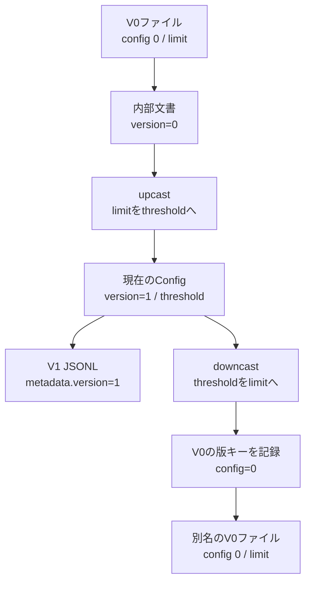

# config 0とversionを使い分けるサンプル

`examples/version_key_names.py`を上から読むと、次の順で構成されています。

1. 現在の`Config`と本文の`Reading`。
2. 通常項目を変えるupcast/downcast。
3. 形式・版キー・モデルを接続する`create_repository`。
4. 保存と再読を実行する`sample_version_key_names`。

これは説明用の設定・測定値を使う架空例です。Configは**RowsDocumentのmetadata**として使います。

## 実行

プロジェクト直下で実行してください。指定する出力先はまだ存在しないフォルダーにします。

```console
python -m examples.version_key_names outputs/version-key-names
```

作るファイルは、V0の入力、V1の出力、V0への別名出力の3つです。
元のV0ファイルは上書きせず、出力の再読結果と元ファイルのバイト列も確認します。
見本ファイル：[V0入力](../sample_outputs/version_key_names/source_v0.blocks)、
[V1出力](../sample_outputs/version_key_names/current_v1.jsonl)、
[V0再出力](../sample_outputs/version_key_names/export_v0.blocks)。

| 場所 | 版キー | 業務項目 |
|---|---|---|
| source_v0.blocks | config 0 | limit: 2.5 |
| 現在のConfigモデル | version=1 | threshold=2.5 |
| current_v1.jsonlのmetadata | version: 1 | threshold: 2.5 |
| export_v0.blocks | config 0 | limit: 2.5 |

## 三つの指定の役割

```python
VersionConverter(
    current_version=1,
    version_field="version",
    upcasts={0: upcast_config},
    downcasts={1: downcast_config},
)
```

`version_field`は**cast用の文書直下のキー**です。
両方のcastで`document["version"]`を参照します。旧ファイルにconfigと書かれていても変えません。

```python
metadata_version_fields={0: "config", 1: "version"}
```

これは**ファイルのmetadataに書かれる版キー**の対応です。
V0を読む際はconfigから版を取り、upcast後は現在版のversionをmetadataへ記録します。
V0へ出力するときは、downcast後にconfigを書きます。古いconfigフィールドを現在のConfigクラスへ定義する必要はありません。

```python
CsvHeaderField.whitespace("config")
```

これは**V0ファイルの物理的な書式**です。configと値を空白で区切ります。
config: 0ならseparated、config0ならcompactを使います。

## castが担当すること

`upcast_config`はlimit→threshold、`downcast_config`はthreshold→limitだけを扱います。
metadataの版キーの変更と、内部の版番号の更新は共通処理が担当します。



## codecとinitの関係

このサンプルでは`VersionedRowsRepository.for_models()`を使います。
利用側でdecode_current・encode_currentを実装する必要はありません。

内部では、モデル登録からcodecを作り、既存の__init__へ
`decode_current=codec.decode`、`encode_current=codec.encode`として接続します。
現在の__init__にcodecという引数があるわけではありません。
独自の組み立てが必要な場合だけ、従来のcallback方式を使えます。

`Config`はメタのモデル、`Reading`は行モデルです。
したがってJSONLの`__meta__.models`に入る登録名はreadingで、Configではありません。
`__meta__.schema_version`も形式管理用であり、ここで扱うファイルの版とは別です。
