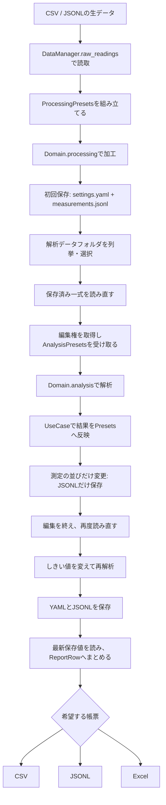

# 生データから帳票まで

実行する全体例は`python main.py outputs/demo`です。処理の本体はUseCase/end_to_end.pyのrun、表示はView/end_to_end.pyにあります。



合成入力の値は10、18、22、30です。加工は先頭値を基準に差分へ倍率を掛け、0、8、12、20にします。解析はしきい値に近い順に確認順位を決め、しきい値を超える件数を集計します。最初のしきい値10では2件、再解析の18では1件です。実業務の解析を再現するものではなく、ファイルと処理の接続を追える計算です。

```python
from pathlib import Path
from UseCase.analysis import AnalysisWorkspace, apply_analysis_result
from Domain.analysis import analyze_readings

workspace = AnalysisWorkspace(Path("outputs/demo/datasets/sample01"))
with workspace.edit() as presets:
    presets.threshold = 15
    result = analyze_readings(presets)       # 計算だけ。presetsは変わらない
    apply_analysis_result(presets, result)   # 確認順を編集値へ反映
    workspace.save_settings(presets, overwrite=True)
    workspace.save_measurements(presets, overwrite=True)
```

`result.summary`が表示用の集計、`apply_analysis_result`が編集値への反映です。計算後にしきい値や測定値が変わっていれば、反映はエラーにして再計算を求めます。反映してもファイルは更新されず、保存は変更対象ごとに選びます。

計算はDomain、反映と実行順はUseCase、編集権と保存はAnalysisWorkspaceの役割です。入力値だけで計算を試せるうえ、いつ編集・保存するかが呼出箇所で分かります。WorkspaceはPresetsそのものではなく、編集期間を管理する窓口です。

編集期間は共有の所有者情報で管理し、保存の確定時に編集権を再検証します。強制引継ぎと導入条件は[共有編集権](SHARED_EDITING.md)を参照してください。エディタ等から直接書き換える操作をOS全体で禁止するものではありません。

初回は設定と測定を両方保存します。以降は変更したファイルだけを保存します。これは複数ファイルの一括コミットではありません。途中で停止すれば一式に新旧が混ざる可能性があり、詳細はLIMITATIONS.mdに示します。

互換出力・旧項目保持・外部集約情報の更新は`python -m examples.workflow outputs/compat-demo --excel`で追えます。外部更新は保存成功後に実行し、失敗時は保存済みデータから再試行できます。DBと実画面の更新ボタンは接続していません。
