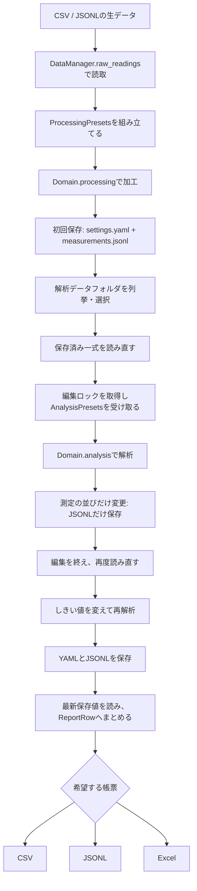

# 生データから帳票まで

実行する全体例は`python main.py outputs/demo`です。処理の本体はUseCase/end_to_end.pyのrun、表示はView/end_to_end.pyにあります。



合成入力の値は10、18、22、30です。加工は先頭値を基準に差分へ倍率を掛け、0、8、12、20にします。解析はしきい値以上の測定を確認順の先頭へ並べます。最初のしきい値10では2件、再解析の18では1件です。実業務の解析を再現するものではなく、ファイルと処理の接続を追える計算です。

```python
from pathlib import Path
from UseCase.analysis import AnalysisService
from Domain.analysis import analyze_readings

service = AnalysisService(Path("outputs/demo/datasets/sample01"))
with service.edit() as presets:
    presets.threshold = 15
    result = analyze_readings(presets)
    service.save_settings(presets, overwrite=True)
    service.save_measurements(presets, overwrite=True)
```

編集開始から読込・変更・保存まで同じフォルダのロックを保持します。ほかの編集者は同じ規約のロックを取得する必要があります。エディタ等から直接書き換える操作をOS全体で禁止するものではありません。

初回は設定と測定を両方保存します。以降は変更したファイルだけを保存します。これは複数ファイルの一括コミットではありません。途中で停止すれば一式に新旧が混ざる可能性があり、詳細はLIMITATIONS.mdに示します。

互換出力・旧項目保持・外部集約情報の更新は`python -m examples.workflow outputs/compat-demo --excel`で追えます。外部更新は保存成功後に実行し、失敗時は保存済みデータから再試行できます。DBと実画面の更新ボタンは接続していません。
