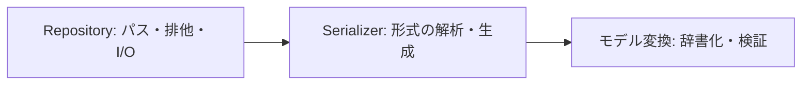

# DataManager redesign

BaseModelを中心とするファイル入出力の再設計です。JSON・YAML・CSV・JSONL・独自テキストv1・読み取り専用Waveformに対応しています。

## コーディングルール

[AGENTS.md](../../previous_projects/data_manager_redesign/AGENTS.md)に、属性の公開範囲・命名・docstring・戻り値注釈・段落のルールを記録しています。

今回、生成時の引数名を`base_directory`、`serializers_by_extension`、`lock_timeout_seconds`へ変更しました。
初期実装の`base_dir`、`serializers_by_ext`、`lock_timeout`から呼び出し側も変更してください。
`load` / `save` / `append_jsonl`の操作名は共通です。独自テキストは型を保持するv1へ変更しています。

## 最初に読むもの

- [MODEL_BOUNDARIES.md](MODEL_BOUNDARIES.md): Presets / Settingsの役割と、同じモデルを共用する判断（設計案）。
- [VERSIONING_DESIGN.md](VERSIONING_DESIGN.md): 版の更新ルールと旧版互換の課題（未実装の設計案）。

- [SERVICES.md](../../previous_projects/data_manager_redesign/SERVICES.md): ユースケースで使うservicesモジュールの構成例。
- [REVIEW_REPORT.md](../../previous_projects/data_manager_redesign/REVIEW_REPORT.md): レビューで修正した問題と、未実装の設計提案。

- [FORMATS.md](../../previous_projects/data_manager_redesign/FORMATS.md): 各形式の使い方、YAML合成、CSVの制約、波形の社内側接続。

- [API_PROPOSAL.md](../../previous_projects/data_manager_redesign/API_PROPOSAL.md): 合意内容・公開API・現在の対応範囲。
- [src/data_manager/repositories.py](../../previous_projects/data_manager_redesign/src/data_manager/repositories.py): 読む・保存する・追記する処理の順序。
- [src/data_manager/model_conversion.py](../../previous_projects/data_manager_redesign/src/data_manager/model_conversion.py): モデルの辞書化とPydantic検証。
- [src/data_manager/waveform.py](../../previous_projects/data_manager_redesign/src/data_manager/waveform.py): ヘッダー解析・復号を注入する波形専用の入口。
- [IMPLEMENTATION_REVIEW.md](../../previous_projects/data_manager_redesign/IMPLEMENTATION_REVIEW.md): 元の実装を再利用・修正・廃止する理由。
- [DESIGN.md](../../previous_projects/data_manager_redesign/DESIGN.md): 最初の検討記録。現行仕様はAPI_PROPOSAL.mdを参照。

## 実行

Python 3.12以上。Windows PowerShellで、このフォルダーを開いて実行します。
専用の`.venv`は作成済みです。別環境へ移す場合は先に仮想環境を作ってください。

```powershell
.\.venv\Scripts\python.exe -m pip install -e '.[dev]'
.\.venv\Scripts\python.exe example.py
.\.venv\Scripts\python.exe examples/application_services.py
.\.venv\Scripts\python.exe -m pytest -q
.\.venv\Scripts\python.exe -m pyright
```

PyrightにはNode.jsが必要です。Pylance画面自体の検証ではなく、同系の型検査器で確認しています。
`typecheck/positive.py`で返却型とisinstanceの絞り込みを検証します。
`typecheck/negative.py`は誤った型の保存を3か所含むため、通常の検査対象から除外しています。
これを個別にPyrightへ渡した場合は、3件のreportArgumentTypeが期待結果です。
`typecheck/services_negative.py`も同様に3件の誤入力を検出し、サービス経由でも型制約を維持することを確認します。

## ユースケースで使う場合

[examples/application_services.py](../../previous_projects/data_manager_redesign/examples/application_services.py)のように、アプリのservicesモジュールで保存先とRepositoryを一度だけ組み立てます。
ユースケースは`services.settings.load()`、`services.events.append(rows)`のように用途だけを選べます。
型変換・排他・例外は既存Repositoryへ委譲し、サービス側へ複製しません。

## 基本の使い方

```python
from pathlib import Path
from pydantic import BaseModel
from data_manager import ObjectRepository, RowsRepository

class User(BaseModel):
    id: str
    name: str = ""

class Event(BaseModel):
    message: str

users = ObjectRepository(model=User, base_directory=Path("data"))
users.save("user.json", User(id="u1"))
user = users.load("user.json")  # User

events = RowsRepository[User | Event](model=(User, Event), base_directory=Path("data"))
events.save("events.jsonl", [user, Event(message="started")])
rows = events.load("events.jsonl")  # list[User | Event]
```

混在JSONLは次の形です。型名の登録操作と、モデルへのtypeフィールド追加は不要です。

```json
{"__meta__":{"schema_version":1,"mode":"mixed","models":["Event","User"],"tag_field":"type"}}
{"type":"User","id":"u1","name":""}
{"type":"Event","message":"started"}
```

業務フィールドと`type`が衝突する場合はエラーにします。変更例:

```python
from data_manager import JsonlSerializer

events = RowsRepository[User | Event](
    model=(User, Event),
    base_directory=Path("data"),
    serializers_by_extension={".jsonl": JsonlSerializer(tag_field="record_kind")},
)
```

単一モデルの行にはtagを付けません。dictモードは`ObjectRepository[dict[str, Any]](model=dict, ...)`
または`RowsRepository[dict[str, Any]](model=dict, ...)`を使います。

## 処理の構造



Repositoryのloadを読むと、ファイル読み込み→形式解析→指定モデルの検証へ進みます。
モデル固有の項目名による分岐はありません。独自のalias逆引きや未知キーの削除もありません。

## 保証と現在の範囲

- ロックはportalockerによるsidecar方式。取得失敗時にロックなしへ切り替えません。
- 全件保存は同じディレクトリの一時ファイルを置換し、失敗時の一時ファイルも片付けます。
- 追記はバッチを検証した後、1回の排他範囲で新規作成または追記します。
- 追記中のI/O障害・異常終了で末尾が不完全になる可能性は残ります。自動修復は行いません。
- JSONL全件保存は常にメタを生成します。追記では既存メタを検査して保持します。
- JSONL追記は先頭と末尾を調べ、既存の中間行をすべて再検証する処理ではありません。
- 同じsidecarロックを使うプログラム間で排他します。
- クラス名を変更する長期保存用途では`JsonlSerializer(model_tags={User: "user"})`で固定名を指定します。
- 入力aliasと出力aliasの往復はモデル側の入力設定に従います。出力専用aliasを自動で入力名に変換しません。

**未実装:** Excel保存との結合、メタ情報取得API、修復API。
波形は社内側のheader_reader接続が必要です。実ヘッダー・実復号の結合検証は、合成テストとは別に実施してください。

元のコードは`../mhi/DataManager`、帳票側は`../excel_reports`を参照しています。
