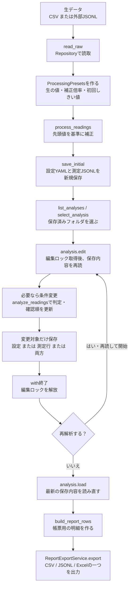
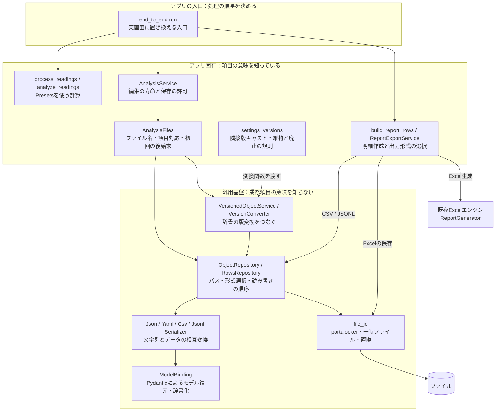
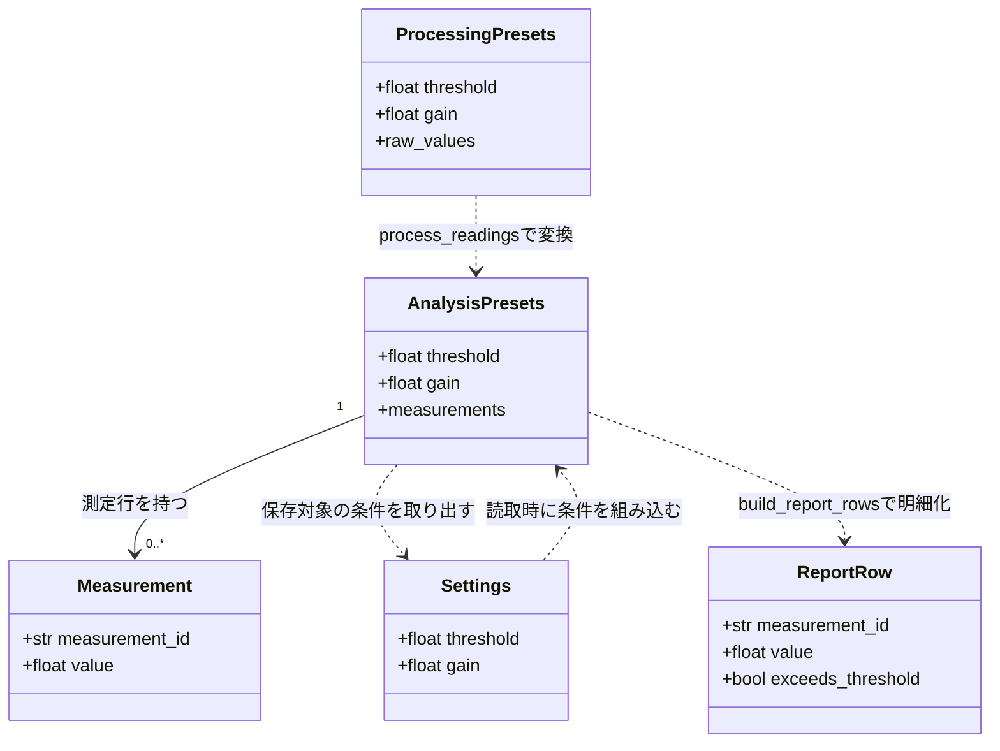
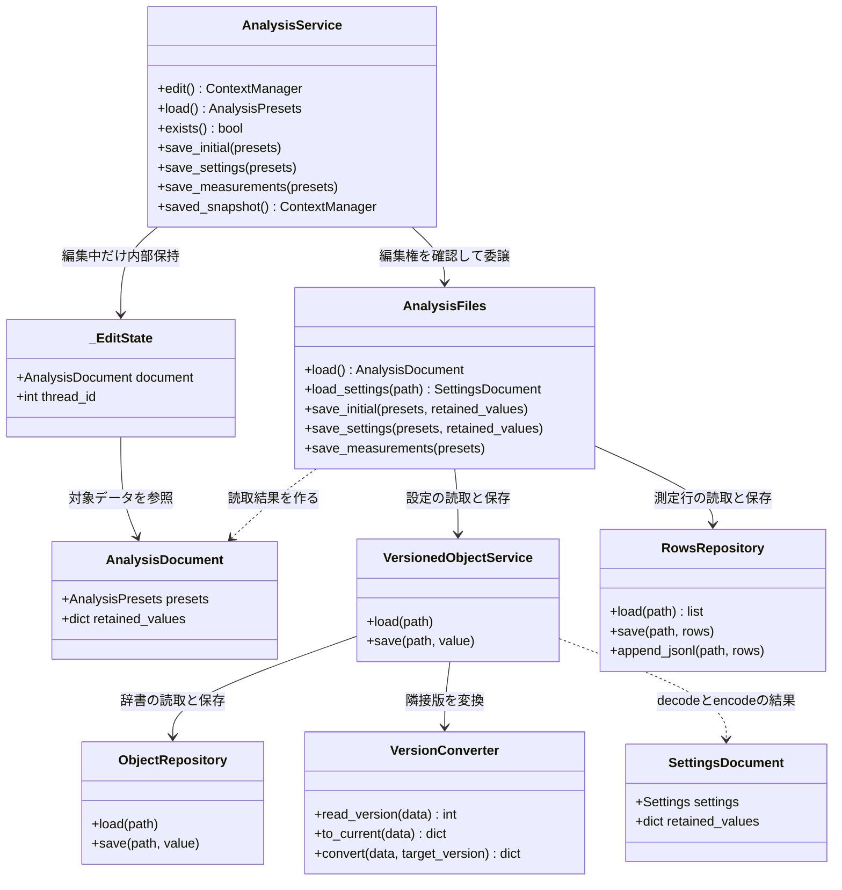
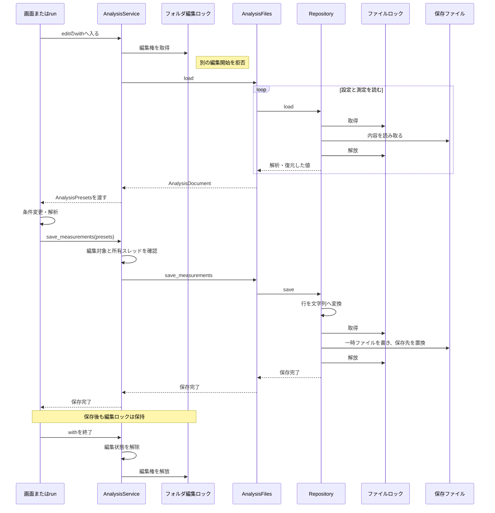
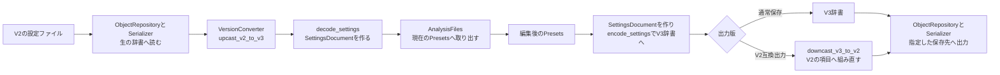
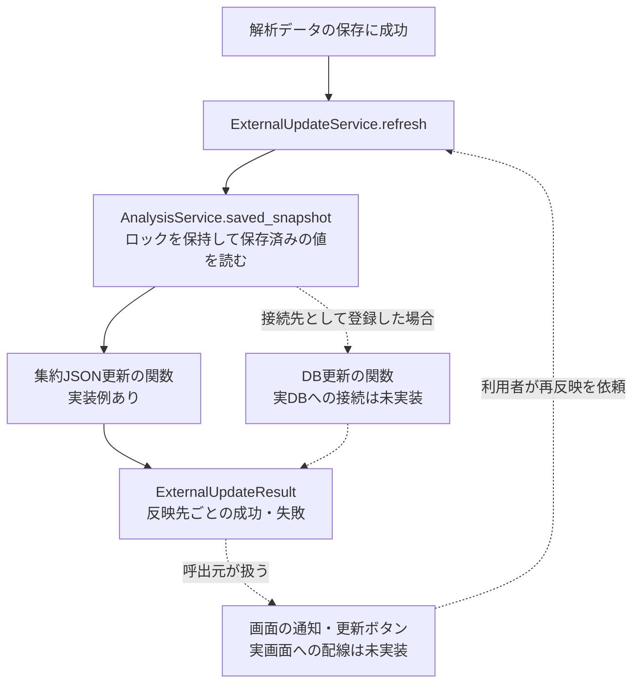

# 図で読む、加工・解析・入出力の全体像

Excel帳票側も含む実際のフォルダー配置は[FILE_LAYOUT.md](FILE_LAYOUT.md)を参照してください。

2026-11-01 / v0.4.1の実装に対応。将来案ではなく、現在のサンプルとモジュールを説明する。

最初は1→2→3の順で読む。実際にコードを追うときに4→5、過去データとの互換性を見るときに6へ進む。
各図は対象を絞っており、全クラス・全引数を列挙するものではない。

## 1. 利用者から見た処理の順番



この図の再解析ループでは、前回のメモリ上の値を使い回さず、毎回保存内容を読み直す。
同じ解析フォルダを更新するので、解析の回数だけファイルが増える構成ではない。
図は共通手順をループでまとめている。実行例のrunでは、初回と再解析を二つのwithとして明示している。

`examples/end_to_end.py`では、最初のしきい値10を、再解析で18へ変更する。
確認順と超過件数が変わるが、加工済みの数値は再補正しない。

| 段階 | 保存するもの | 理由 |
| --- | --- | --- |
| 加工直後 | 設定YAMLと測定JSONL | 初めて解析データ一式を作る |
| 初回解析 | 測定JSONLだけ | 確認順だけが変わった |
| 再解析 | 設定YAMLと測定JSONL | しきい値と確認順の両方が変わった |
| 帳票 | 選択した形式の一ファイル | 最新の保存内容から報告用の明細を作る |

標準実行の出力は、データファイル三つと技術用のロックファイル。

```text
end_to_end_example/
  datasets/sample01/
    settings.yaml
    measurements.jsonl
  report.csv
```

## 2. モジュールの分担と呼び出し方向



矢印は主な呼び出し・委譲の方向を表す。データを受け取って返す経路は省略している。
`read_raw`からもRowsRepositoryを使うが、図の交差を減らすためその矢印は省略した。

読み方のポイントは次の三つ。

1. **計算はPresetsを受け取り、ファイルを開かない。** 計算方法を変えてもRepositoryを変える必要はない。
2. **保存先と項目対応はAnalysisFilesに置く。** 各解析メソッドへファイル名やSettingsの参照を散らさない。
3. **RepositoryとSerializerを分ける。** 排他・保存と、CSVやYAMLの解釈を別の場所で保守する。

図の汎用的な「モデル復元・辞書化」は、全モデルを保存直前に再検証する保証ではない。
一般化した保存時の再検証は、別途合意済み・未実装の事項として残っている。

## 3. データのクラス図：何を持つモデルなのか



この図の実線は「持っている関係」、点線は「関数や保存処理による変換の対応」。
継承関係を表しているわけではない。対象モデルはPydanticのBaseModelを使うが、その共通基底は省略した。

**PresetsにSettingsを子としてぶら下げていない。** 処理に必要なthreshold・gainをPresetsに明示している。
項目対応は保存境界へ集め、利用側は`presets.threshold`と直接扱う。

**AnalysisPresets全体を一つのファイルへdumpしていない。** 次の対応で保存する。

| メモリ上の項目 | 保存先 | 対応を決める場所 |
| --- | --- | --- |
| threshold / gain | settings.yaml | AnalysisFiles.save_settings |
| measurements | measurements.jsonl | AnalysisFiles.save_measurements |
| 旧版から維持する値 | 設定文書のretained_values | settings_versionsとAnalysisFiles |
| 確認用の平均・最大・超過件数 | この例では別ファイルに保存しない | ReviewSummaryで画面・ログへ返す |

現在の例で測定JSONLへ保存する解析結果は行の確認順。超過判定は、帳票作成時に保存済み条件から計算する。
実業務で判定結果自体を保存するなら、保存モデルへ項目を明示して追加する。

## 4. 入出力と編集管理のクラス図：誰へ委譲するのか



メソッドの引数・型は読みやすさのため一部省略した。実線は保持して使う参照、点線は生成・変換の依存を表す。

`edit()`の戻り値はコンテキストマネージャーで、その`with ... as presets`がAnalysisPresetsを渡す。
`AnalysisDocument`や`SettingsDocument`は保存境界の情報をまとめる入れ物で、画面が編集する中間Editorではない。
_EditStateは編集対象と所有スレッドを記録する内部クラス。利用側がこれらをたどって処理値を取得する必要はない。

```python
with analysis.edit() as presets:
    presets.threshold = 18
    analyze_readings(presets)
    analysis.save_settings(presets, overwrite=True)
    analysis.save_measurements(presets, overwrite=True)
```

AnalysisServiceは「どの編集で取得したPresetsか」を確認し、AnalysisFilesへ保存を依頼する。
維持項目を各処理メソッドへ持ち回らせたり、利用側が内部のdocumentをたどったりする必要はない。

## 5. シーケンス図：いつ編集ロックを保持しているのか



図は測定ファイルの全件保存が成功する経路。設定読取の版変換等の中間処理は省略し、ロックの寿命に焦点を当てている。
例外終了でもwithの後始末で編集ロックを解放する。
JSONLの直接追記は異なる保存方式で、この一時ファイル置換の図には含めていない。

- **フォルダロック**：読み込みから編集終了まで、同じデータ一式の編集を一人に限定する。
- **ファイルロック**：個々の読み書きの間だけ、同じ保存対象の操作を守る。
- **一時ファイルの置換**：一ファイルの不完全な書込を保存先へ見せない。

二つのファイルの保存を一つの取引にする保証ではない。
初回保存の通常失敗では作成物を削除するが、既存ファイル二つの更新途中の障害や電源断まで、一括で巻き戻すものではない。
一般の外部エディタにはこの協調ロックは強制されないので、手修正はアプリの編集終了後に行う。

## 6. 版互換の図：現在モデルへ揃える場所



現在の設定例の最新版はV3。版なしV0からV1・V2を経由する読取関数もある。
end_to_endの標準実行は最初からV3を保存するので、通常その実行では旧版からのupcastは行わない。
この図は、別の旧設定を取り込んだときに働く実装済みの経路。

| V2の項目 | V3への読取 | V2への出力 |
| --- | --- | --- |
| threashold | thresholdへ改名 | threasholdへ戻す |
| gainなし | 1.0で補完 | V2にないので除外 |
| operator_note | 維持情報へ保持 | 元値を復元 |
| draft_flag | 廃止 | 復元しない |

V2からV6へ進む実業務では、同じVersionConverterへ隣接版の関数を登録して順に適用する。
版ごとのPresetsやBaseModelを増やすことは前提にしていない。
この版番号は保存項目の仕様であり、解析の実行回数ではない。再解析するだけで版は上げない。
JSONLメタのschema_versionはJSONL形式側の仕様で、設定のV3とは別の番号。
旧項目の値の維持と、YAMLのコメント保持は別の課題。版変換後の元コメント保持は現在まだ未実装。

## 7. 名前が似ているservicesと、この例に出てこない経路

| 名前 | 担当 | end_to_endでの使用 |
| --- | --- | --- |
| AnalysisService | 加工・解析アプリの編集手順と保存の許可 | 使用する |
| VersionedObjectService | 辞書の版変換と型付きの設定データを接続 | 設定の内側で使用する |
| ObjectFileService / RowsFileService | 固定パスへload / saveを提供する任意の薄い窓口 | この例では使わない |
| ExternalUpdateService | 保存済みデータをDB等へ反映・再試行 | 実装例はあるが、この例では呼ばない |
| WaveformRepository | 波形のload / peek | この例の入力はCSVなので使わない |


### 外部反映を追加する場合の接続位置



点線はこの例から実DB・実画面へ接続する箇所を示す。自動再試行のループではない。
外部反映は未保存の編集値ではなく、保存済みファイルから読み直した値を使う。
反映先が失敗しても解析データは戻さず、再実行の対象は外部反映だけにする。
この任意の経路を呼ばないend_to_endでは、集約JSONやDB書込は発生しない。

すべてのサービスを重ねる構成ではない。必要な経路だけを組み合わせる。
DBへの実接続、画面のボタン配線、実波形の社内ヘッダー・復号関数の接続は未実装・未確認のまま。

## 8. 図からコードへ進む

| 確認したいこと | 読むファイル |
| --- | --- |
| 全工程をどの順で呼ぶか | [end_to_end.py](examples/end_to_end.py)のrun |
| 計算とモデルの項目 | [analysis_models.py](examples/analysis_models.py)、end_to_end.pyのprocess_readingsとanalyze_readings |
| 編集の開始・終了と保存の許可 | [analysis_workflow.py](examples/analysis_workflow.py) |
| どの項目をどのファイルへ出すか | [analysis_files.py](examples/analysis_files.py) |
| 旧キー・旧版の規則 | [settings_versions.py](examples/settings_versions.py) |
| パス・形式選択・全件保存・追記 | [repositories.py](src/data_manager/repositories.py) |
| ロックと一ファイルの置換 | [file_io.py](src/data_manager/file_io.py) |
| 帳票の明細と出力形式 | [report_export.py](examples/report_export.py) |

操作方法と実行コマンドは[END_TO_END_GUIDE.md](END_TO_END_GUIDE.md)、
責務を分けた理由は[READABILITY_REVIEW.md](READABILITY_REVIEW.md)を参照。
