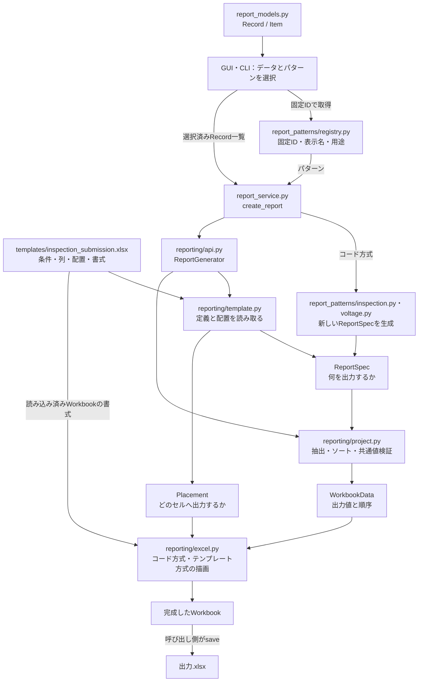
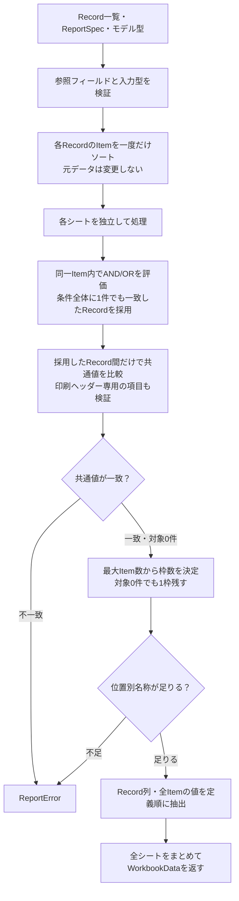
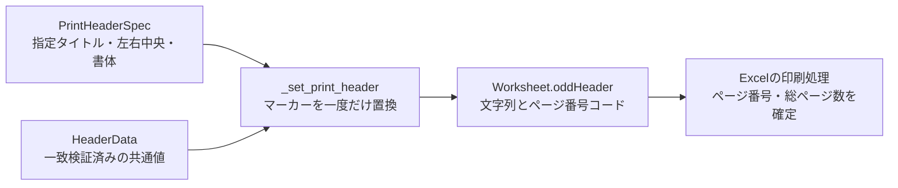
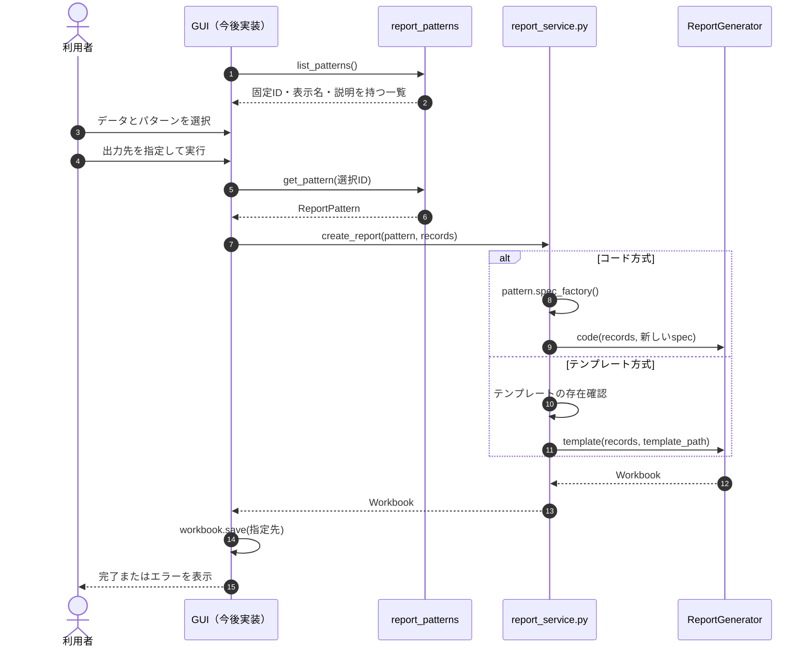
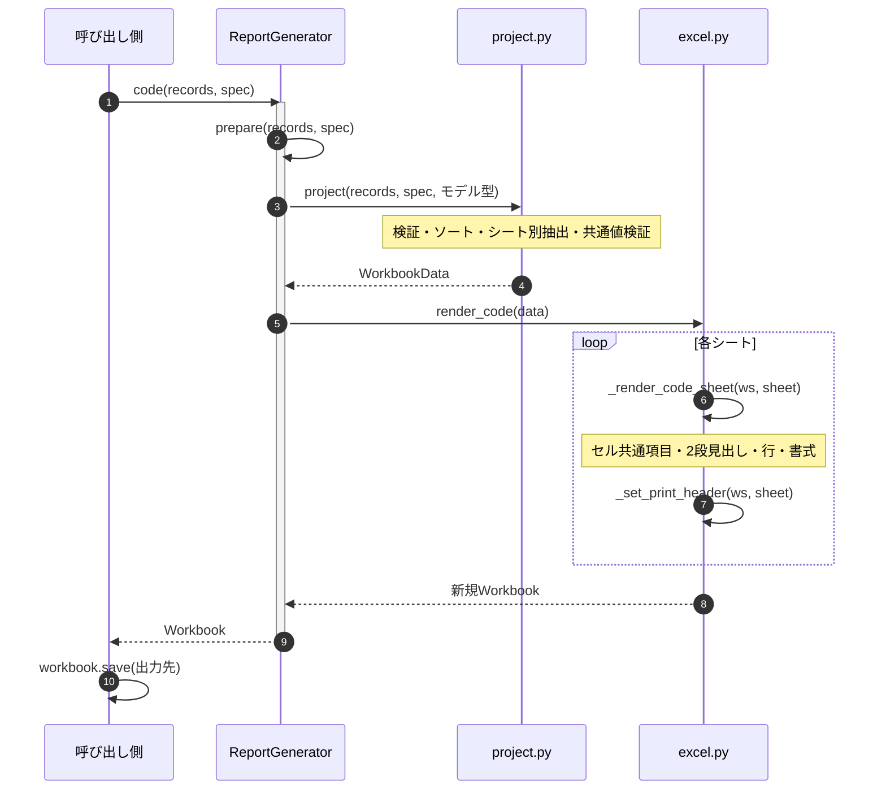
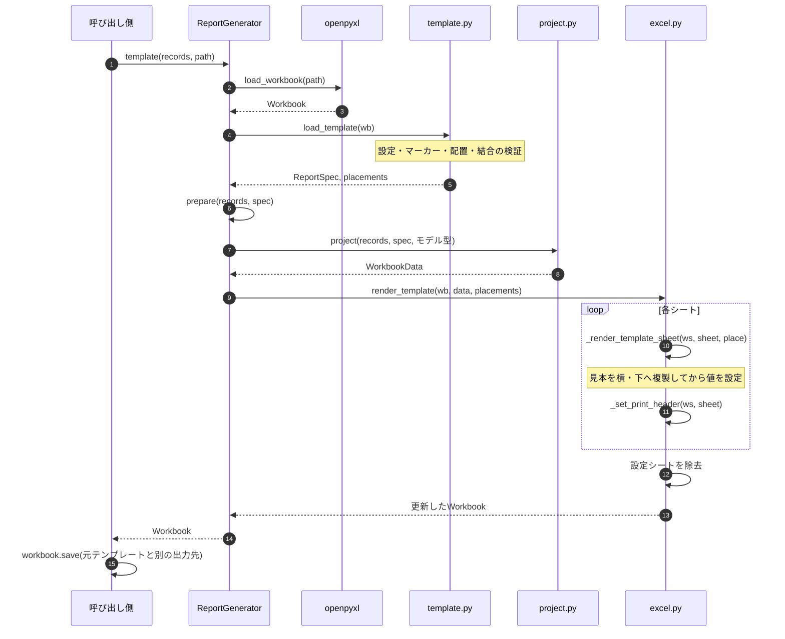
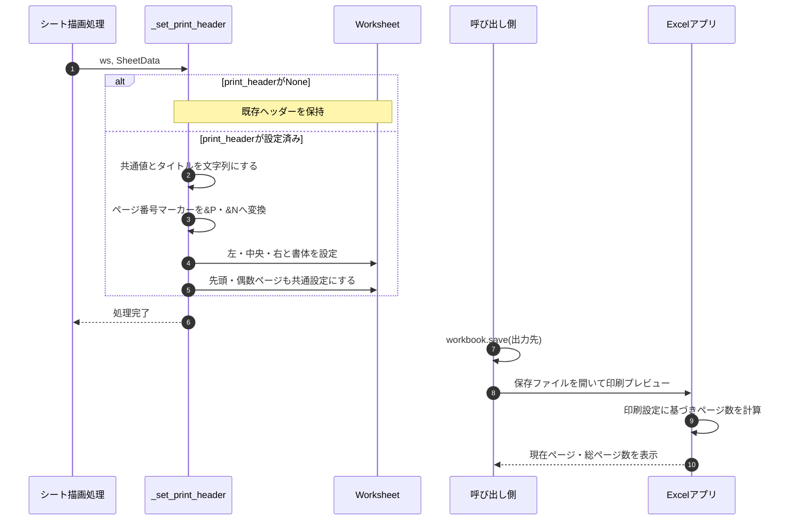

# 帳票出力の構成と呼び出し順

本書は現在の実装と、将来PySide6から呼び出す際の境界を示します。
GUI本体は未実装です。`report_service.py`まではGUIに依存せず実行できます。

## 図の記法

| 記法 | 用途 |
|---|---|
| `flowchart TD` | 構成・処理・分岐を上から下へ表示 |
| `flowchart LR` | データの関係を左から右へ表示 |
| `sequenceDiagram` | 呼び出し先を横に並べ、時間順に上から下へ表示 |

フローチャートの四角は処理・データ、ひし形は判断です。
シーケンス図の`->>`は呼び出し、`-->>`は応答、`loop`は繰り返し、
`alt/else`は分岐、`Note`は補足、`autonumber`はメッセージ番号です。

## 全体構成（flowchart TD）

`reporting/models.py`がSpecとDataを定義します。パターンは1ブック全体に対応し、
複数シートを含められます。テンプレート方式の条件・列を登録一覧へ重複記載しません。

## 共通データ処理（flowchart TD）

一致したItemだけを抜き出す処理ではありません。選んだRecordの全Itemを出力します。
ItemなしのRecordはANY条件に一致せず出力されません。Recordの行順は入力順です。
未採用Recordもソート対象となるため、そのソートエラーは出力前に検出されます。

## 印刷ヘッダーのデータ経路（flowchart LR）

`show_table_headers=False`は共通項目のセル表示を止めます。列見出しは残り、
印刷用共通値の検証も実行します。テンプレートの固定文字や行配置は自動で削除しません。

## GUIからパターンを選ぶ流れ（sequenceDiagram）

GUIは表示名の文字列で分岐せず、選択項目に関連付けた固定IDで取得します。
データ取得・選択・保存先の指定・結果表示はGUI側の責務です。
生成時の例外は呼び出し側へ伝わるため、GUI側で捕捉して表示します。

## コード方式の内部呼び出し（sequenceDiagram）

## テンプレート方式の内部呼び出し（sequenceDiagram）

## 印刷ヘッダーの設定順（sequenceDiagram）

## 変更箇所の目安

| 変更内容 | 変更箇所 |
|---|---|
| 業務モデル | `report_models.py` |
| パターンの追加・表示名・説明 | `report_patterns/registry.py` |
| コード方式の条件・列・ヘッダー | `report_patterns/inspection.py`・`voltage.py` |
| テンプレート方式の条件・列・ヘッダー・書式 | `templates/`内の.xlsx |
| GUIとの接点・モデルの組み合わせ | `report_service.py` |
| 共通のデータ変換 | `reporting/project.py` |
| 描画・複製 | `reporting/excel.py` |

出力ごとに変更したいタイトルなどが増えた場合は、パターンとは別に1回分の
オプションを渡す拡張を検討します。現段階では専用のオプションAPIは未実装です。
